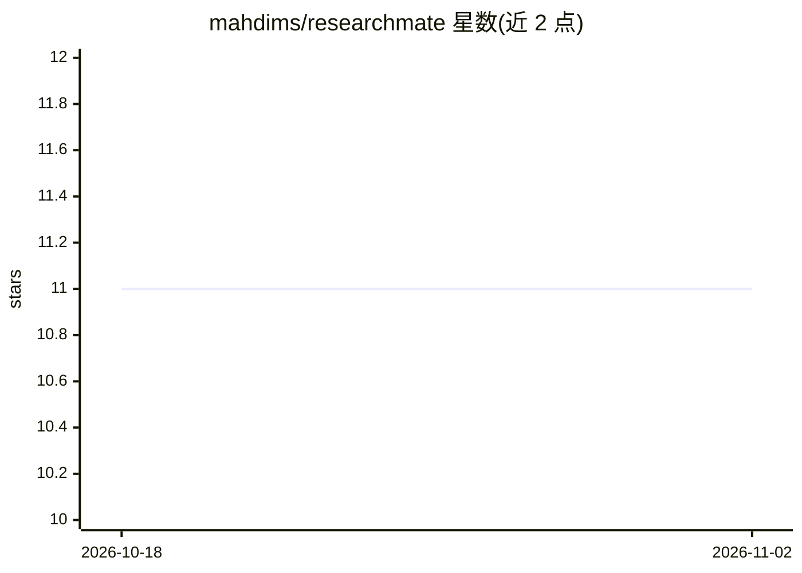

# mahdims/researchmate

⭐ 11 · Python · 推送 2026-10-29 · [GitHub](https://github.com/mahdims/researchmate) · [官网](researchmate.app) · 个人维护

**运筹优化×AI 交叉领域论文策展清单（研究代理筛选评分）**

收录 LLM 用于算法设计、生成式 AI 与运筹学（OR）交叉方向的论文清单：由研究代理对论文做多轮分析、按相关性打分（如 25/30 制），按最新论文、最佳论文、研究前沿三类组织。条目含日期、标题、作者、机构与 pdf/code 链接，并附相关性与方法论的摘要说明。面向跟踪自动算法设计、LLM 演化搜索与组合优化交叉研究的读者，为持续更新的策展资源，不含可安装的软件。

## 筛选速览

| 维度 | 判定 | 备注 |
|---|---|---|
| AI 角色 | `ai-knowledge` | 知识聚合/清单类 |
| 许可风险 | `none` | — |
| 部署形态 | `None` |  |
| 模型依赖 | — | README 未给出锁定关系 |
| 硬件要求 | — | 无带数字的原话,不猜 |
| 安装摩擦 | `low` | 无编译、无系统依赖或容器化 |
| 成熟度 | — | 结构信号不足 |

## 能力要点

- 研究代理多轮分析并按相关性为论文评分
- 三类组织结构：最新论文/最佳论文/研究前沿
- 条目含作者、机构、pdf/code 链接与摘要说明
- 覆盖 LLM 算法设计、OR×生成式 AI 双向交叉

## 适用场景

- 跟踪运筹优化与 LLM 结合的最新论文
- 通过评分快速筛选领域内高相关论文
- 了解 LLM 演化搜索与自动算法设计的研究前沿

## 场景标签

`精选清单` · 领域:学习与行业

## 证据(README 行号)

> L5:  LLMs for Algorithm Design
> L21: ### ⭐ Best Papers

## 星数曲线

2026-10-18 11 → 2026-11-02 11（+0）

---
*卡片 v1 · prompt 1.4 · 生成 2026-11-02 · 置信度 high · 依据 README sha `a25df1b9de9b` · [字段定义](../../DATASET.md)*
