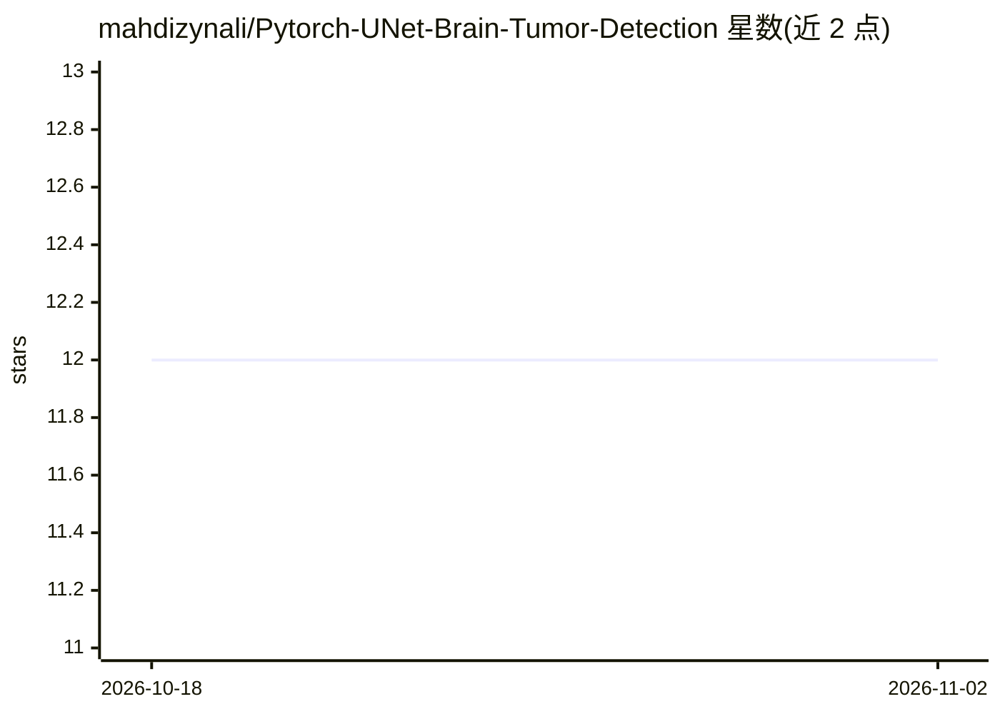

# mahdizynali/Pytorch-UNet-Brain-Tumor-Detection

⭐ 12 · Python · 推送 2026-05-14 · [GitHub](https://github.com/mahdizynali/Pytorch-UNet-Brain-Tumor-Detection) · 个人维护

**给研究/学习者的 PyTorch U-Net 脑肿瘤 MRI 分割训练流水线**

基于 PyTorch 的深度学习训练项目：从 MRI TIFF 图像中分割脑肿瘤区域。读取 Kaggle LGG MRI Segmentation 数据集的图像/掩码对，用 OpenCV 加载、Albumentations 做预处理与增强，训练 U-Net 编码器-解码器模型（输入 3×128×128，输出二值分割掩码），损失为 BCE+Dice，评估用 Dice/IoU 指标并可视化预测。通过 main.py 菜单选择训练或使用已保存模型，CUDA 可用时自动启用。README 声明仅供教育与研究用途，不用于临床诊断。

## 筛选速览

| 维度 | 判定 | 备注 |
|---|---|---|
| AI 角色 | `ai-native` | 本体是模型或模型工具 |
| 许可风险 | `none` | — |
| 部署形态 | `library` | 以包/库形式分发 |
| 模型依赖 | — | README 未给出锁定关系 |
| 硬件要求 | — | 无带数字的原话,不猜 |
| 安装摩擦 | `medium` | 含编译或系统依赖之一 |
| 成熟度 | — | 结构信号不足 |

## 能力要点

- U-Net 分割模型（PyTorch 实现，BCE+Dice 损失）
- Dice/IoU 评估与预测可视化
- OpenCV 加载图像/掩码，Albumentations 数据增强
- CUDA 可用时自动使用 GPU

## 适用场景

- 在 LGG MRI 数据集上训练脑肿瘤分割模型
- 学习 U-Net 医学图像分割的完整流程
- 复用流水线做 MRI 分割实验与调参

## 场景标签

`目标检测` · 领域:感知与多模态

## 证据(README 行号)

> L5: This project implements a simple deep learning pipeline for detecting and segmenting brain tumor regions from MRI im
> L11: - U-Net segmentation model implemented in PyTorch

## 星数曲线

2026-10-18 12 → 2026-11-02 12（+0）

---
*卡片 v1 · prompt 1.4 · 生成 2026-11-01 · 置信度 high · 依据 README sha `4b317c84b6fa` · [字段定义](../../DATASET.md)*
