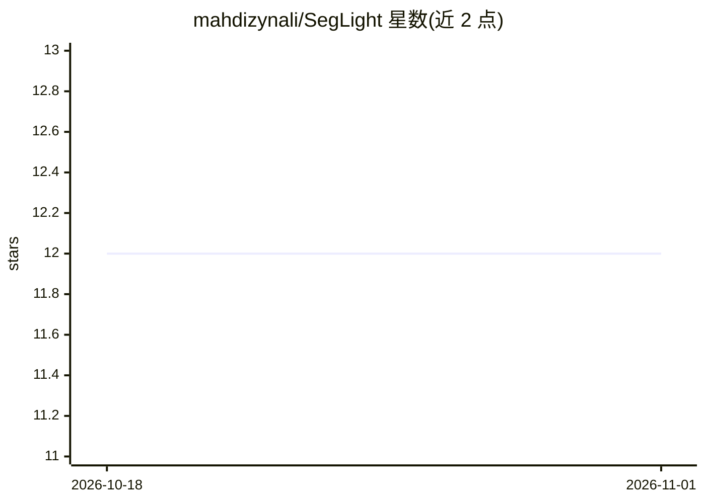

# mahdizynali/SegLight

⭐ 12 · Python · MIT · 推送 2025-11-27 · [GitHub](https://github.com/mahdizynali/SegLight) · 组织维护

**轻量级实时语义分割模型，面向人形足球机器人 CPU 推理**

面向人形足球机器人场景的轻量级语义分割模型实现，目标是在 CPU 单核上实现尽可能短的推理时间。基于 TensorFlow/Keras 训练，用户准备图像与标签数据集、配置色彩映射后运行 main.py 训练；支持通过数据 repeat 选项应对数据量不足。模型保存受 Keras 版本影响：TensorFlow 2.16+ 需安装 tf-keras 并设置 TF_USE_LEGACY_KERAS=1 才能保存 .pb 格式供 C++/cppflow 推理使用。

## 筛选速览

| 维度 | 判定 | 备注 |
|---|---|---|
| AI 角色 | `ai-native` | 本体是模型或模型工具 |
| 许可风险 | `permissive` | MIT |
| 部署形态 | `library` | 以包/库形式分发 |
| 模型依赖 | — | README 未给出锁定关系 |
| 硬件要求 | — | 无带数字的原话,不猜 |
| 安装摩擦 | `low` | 无编译、无系统依赖或容器化 |
| 成熟度 | — | 结构信号不足 |

## 能力要点

- 面向 CPU 单核低推理时间的轻量语义分割模型
- 数据集不足时可用 repeat 选项重复扩充训练数据
- 支持保存 tf 格式 .pb 供 C++/cppflow 推理

## 适用场景

- 人形足球机器人上做实时语义分割
- 在 CPU 单核设备上部署低延迟分割模型
- 用 C++/cppflow 加载训练好的分割模型

## 场景标签

`目标检测` · 领域:感知与多模态

## 证据(README 行号)

> L2: Approch of this project is implementing light weight semantic segmentation model which has the least inference time 
> L20: in tensorflow version 2.16.0 and above, keras kernel updates into version 3 and it limit us to save models only in 

## 星数曲线

2026-10-18 12 → 2026-11-01 12（+0）

---
*卡片 v1 · prompt 1.4 · 生成 2026-11-01 · 置信度 mid · 依据 README sha `149fa1d6e750` · [字段定义](../../DATASET.md)*
