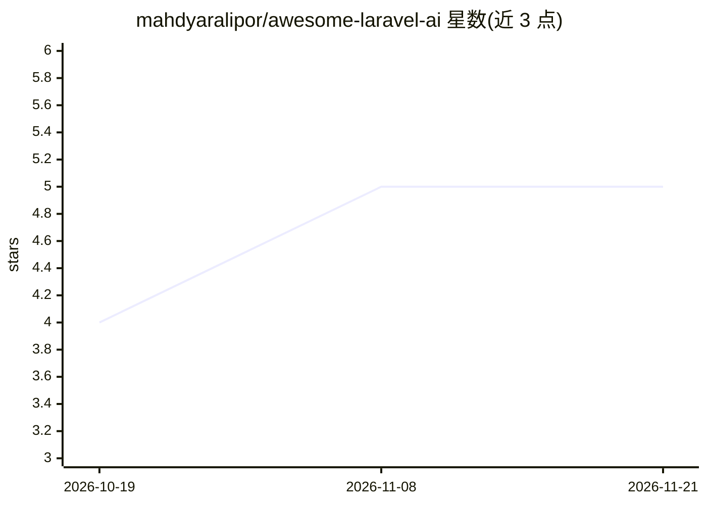

# mahdyaralipor/awesome-laravel-ai

⭐ 5 · CC0-1.0 · 推送 2026-11-09 · [GitHub](https://github.com/mahdyaralipor/awesome-laravel-ai) · 个人维护

**为 Laravel 开发者整合构建 AI agent 与应用的包、工具与教程清单**

围绕 Laravel 官方 AI SDK、MCP 工具包、agent skills 及社区生态的精选清单，按官方资源、agent 框架、RAG 与搜索、Provider 客户端、MCP 服务器、评测与可观测性、开发工具、实际案例和学习教程等类别组织条目。定位为索引型资料集，本身不提供安装命令或运行时代码，仅以条目加一句话说明的形式汇总 PHP/Laravel 生态中用于构建 agent、RAG、MCP 服务的资源。

## 筛选速览

| 维度 | 判定 | 备注 |
|---|---|---|
| AI 角色 | `ai-knowledge` | 知识聚合/清单类 |
| 许可风险 | `viral` | CC0-1.0 |
| 部署形态 | `None` |  |
| 模型依赖 | — | README 未给出锁定关系 |
| 硬件要求 | — | 无带数字的原话,不猜 |
| 安装摩擦 | `low` | 无编译、无系统依赖或容器化 |
| 成熟度 | — | 结构信号不足 |

## 能力要点

- 按官方资源、agent 框架、RAG、MCP 服务器等类别组织的精选清单
- 收录 Laravel 官方 AI SDK、MCP toolkit 与 agent skills 资源
- 包含 Laracasts 教程系列与实际开源案例条目

## 适用场景

- 为 Laravel 项目查找构建 AI agent 的框架与工具
- 了解 PHP 生态中可用的 RAG 与 MCP 相关库
- 查找学习 Laravel AI 开发的教程资料

## 场景标签

`精选清单` `教程课程` · 领域:学习与行业

## 证据(README 行号)

> L5: > Curated packages, tools, tutorials and examples for building AI agents and AI-powered apps with Laravel.
> L7: Laravel shipped a first-party AI SDK, an MCP toolkit, official agent skills and a skills directory — and a community
> L9: ## Contents

## 星数曲线

2026-10-19 4 → 2026-11-21 5（+1）

---
*卡片 v1 · prompt 1.4 · 生成 2026-11-21 · 置信度 high · 依据 README sha `e217e77fd7f2` · [字段定义](../../DATASET.md)*
