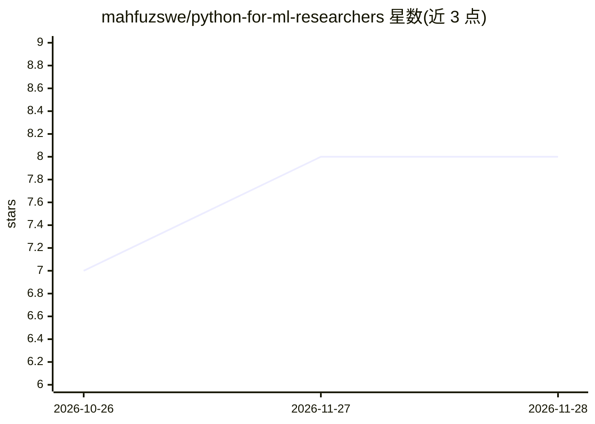

# mahfuzswe/python-for-ml-researchers

⭐ 8 · Jupyter Notebook · MIT · 推送 2026-10-19 · [GitHub](https://github.com/mahfuzswe/python-for-ml-researchers) · 个人维护

**面向 ML/DL 研究者的 Python 核心概念速成教程笔记本**

单一 Jupyter 笔记本，以 26 章、5 个部分覆盖 Python 核心概念（基础语法、函数、异常处理、OOP、NumPy/Pandas），每个概念的示例取自 ML 工作场景（训练循环、配置字典、PyTorch 风格 Dataset 类），每章附练习任务与隐藏解答。末章以 NumPy 从零实现逻辑回归作为毕业项目。可在 Google Colab 直接打开运行，或本地 clone 后通过 requirements.txt 安装依赖运行，需 Python 3.10+。

## 筛选速览

| 维度 | 判定 | 备注 |
|---|---|---|
| AI 角色 | `ai-knowledge` | 知识聚合/清单类 |
| 许可风险 | `permissive` | MIT |
| 部署形态 | `library` | 以包/库形式分发 |
| 模型依赖 | — | README 未给出锁定关系 |
| 硬件要求 | — | 无带数字的原话,不猜 |
| 安装摩擦 | `low` | 无编译、无系统依赖或容器化 |
| 成熟度 | — | 结构信号不足 |

## 能力要点

- 26 章 Jupyter 笔记本，覆盖 Python 核心概念，预计 2-3 小时完成
- 所有示例围绕 ML/DL 场景（训练循环、数据泄漏检测、配置管理）
- 每章含练习任务与折叠解答，末章从零实现逻辑回归
- 支持 Colab 零配置运行

## 适用场景

- 补齐自学过程中零散掌握的 Python 知识缺口
- 作为 ML 课程的实验课或训练营材料
- 进入 ML 领域前快速熟悉该领域的 Python 惯用法

## 场景标签

`教程课程` · 领域:学习与行业

## 证据(README 行号)

> L7: A single, hands-on Jupyter notebook. Plain-English explanations, real ML examples,
> L15: 26 chapters

## 星数曲线

2026-10-26 7 → 2026-11-28 8（+1）

---
*卡片 v1 · prompt 1.4 · 生成 2026-11-20 · 置信度 high · 依据 README sha `64a81dd56ef0` · [字段定义](../../DATASET.md)*
