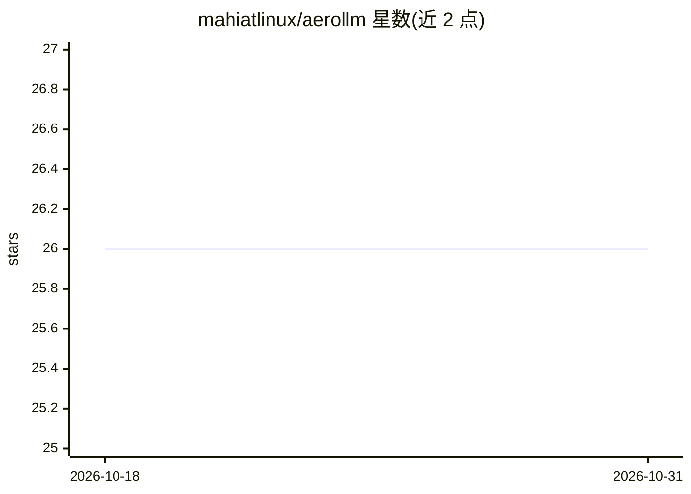

# mahiatlinux/aerollm

⭐ 26 · TypeScript · 推送 2026-06-16 · [GitHub](https://github.com/mahiatlinux/aerollm) · 个人维护

**面向 Apple Silicon Mac 的本地 LLM 聊天应用，MLX 推理**

面向 Apple Silicon Mac 用户的本地大模型聊天桌面应用：从 Hugging Face 搜索并下载 MLX 格式模型（支持断点续传），设备端运行文本模型（mlx-lm）与视觉语言模型（mlx-vlm），聊天支持流式输出、Markdown/KaTeX/Mermaid 渲染、消息编辑与会话历史搜索。可选开启 OpenAI 兼容 API 服务端（默认关闭，仅绑定 localhost），并可选安装 mlx-audio 运行时实现语音转文字与文字转语音。前端 Tauri v2 + React，后端 Rust，内置 CPython 运行时承载推理。仅支持 arm64 且需 macOS 14 以上，通过 DMG 安装。

## 筛选速览

| 维度 | 判定 | 备注 |
|---|---|---|
| AI 角色 | `ai-native` | 本体是模型或模型工具 |
| 许可风险 | `none` | — |
| 部署形态 | `desktop` | 安装包/桌面程序 |
| 模型依赖 | — | README 未给出锁定关系 |
| 硬件要求 | — | 无带数字的原话,不猜 |
| 安装摩擦 | `low` | 无编译、无系统依赖或容器化 |
| 成熟度 | — | 结构信号不足 |

## 能力要点

- Hugging Face MLX 模型搜索、下载（断点续传）与本地库管理
- 设备端 MLX 推理（文本 mlx-lm / 视觉语言 mlx-vlm），流式输出
- 可选 OpenAI 兼容 API 端点（/v1/chat/completions、/v1/models）
- 可选语音功能：安装 mlx-audio 运行时后支持语音转文字与文字转语音

## 适用场景

- 在 Mac 上完全本地运行大模型并与模型对话
- 下载并管理 Hugging Face 上的 MLX 模型
- 为其他应用暴露本地 OpenAI 兼容接口

## 场景标签

`聊天机器人` `多模态` · 领域:对话与助手

## 证据(README 行号)

> L3: A local LLM chat app for Apple Silicon Macs. It browses and downloads models from
> L72: - Inference. A bundled CPython runtime runs mlx-lm for text models and mlx-vlm for

## 星数曲线

2026-10-18 26 → 2026-10-31 26（+0）

---
*卡片 v1 · prompt 1.4 · 生成 2026-10-26 · 置信度 high · 依据 README sha `85e0d8147c88` · [字段定义](../../DATASET.md)*
