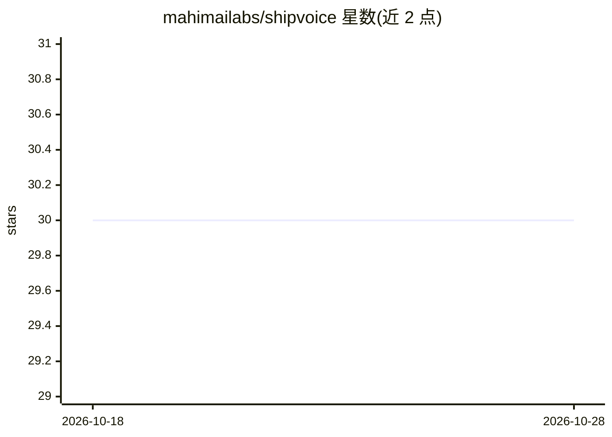

# mahimailabs/shipvoice

⭐ 30 · TypeScript · NOASSERTION · 推送 2026-10-07 · [GitHub](https://github.com/mahimailabs/shipvoice) · [官网](https://docs.shipvoice.dev) · 组织维护

**浏览器语音 agent 全栈启动模板：worker+令牌服务+前端**

MIT 许可的实时语音 agent 起步工程，包含三块可独立运行、部署与替换的部分：LiveKit 语音 worker（Deepgram STT、Cerebras LLM、Inworld TTS、Silero VAD、多语种轮次检测）、签发房间令牌的 FastAPI 后端、基于 LiveKit Agents UI 的 React 前端（音频可视化、实时转写、文字聊天）。支持 Web 与 SIP 电话同 agent 接入、自托管或 LiveKit Cloud 一行切换、SIGTERM 排空在途通话。提供 Docker 一键启动与手动运行两种方式；另有付费版 ShipVoice Pro（计费、鉴权、合规），为独立仓库非插件。注意：后端无鉴权，LiveKit 签名密钥以明文存于 Postgres。

## 筛选速览

| 维度 | 判定 | 备注 |
|---|---|---|
| AI 角色 | `ai-ecosystem` | LLM/agent 周边工具 |
| 许可风险 | `none` | NOASSERTION |
| 部署形态 | `self-host` | docker 或自建部署 |
| 模型依赖 | — | README 未给出锁定关系 |
| 硬件要求 | — | 无带数字的原话,不猜 |
| 安装摩擦 | `low` | 无编译、无系统依赖或容器化 |
| 成熟度 | — | 结构信号不足 |

## 能力要点

- 三段式结构（agent/backend/frontend）可独立运行、部署与替换
- 同一 agent 通过单参与者分支同时支持 Web 与 SIP 电话
- worker 在 SIGTERM 时排空在途通话，支持蓝绿零停机部署
- Docker Compose 一条命令拉起 Postgres、后端、agent 与前端

## 适用场景

- 快速搭建并拥有一个可二次开发的浏览器语音 agent
- 学习 LiveKit 实时语音 agent 的生产级工程结构
- 在自托管 LiveKit 与 LiveKit Cloud 之间切换部署

## 场景标签

`语音 Agent` · 领域:对话与助手

## 证据(README 行号)

> L6:  The free MIT starter for real-time voice agents: a LiveKit voice worker, a
> L24: Most voice-AI demos are a single script. This is the whole loop, structured the
> L25: way you'd actually ship it, and split into three pieces you can run, deploy, and

## 星数曲线

2026-10-18 30 → 2026-10-28 30（+0）

---
*卡片 v1 · prompt 1.4 · 生成 2026-10-26 · 置信度 high · 依据 README sha `58e58041549c` · [字段定义](../../DATASET.md)*
