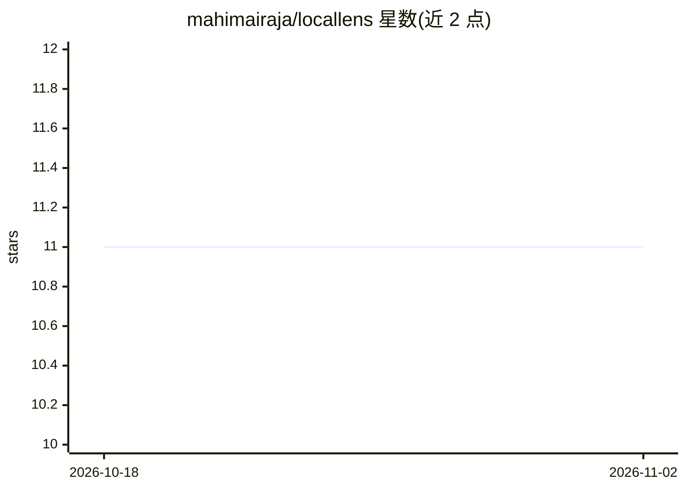

# mahimairaja/locallens

⭐ 11 · Python · MIT · 推送 2026-04-23 · [GitHub](https://github.com/mahimairaja/locallens) · [官网](https://locallens.mahimai.ca) · 个人维护

**本地离线的文件语义搜索与 RAG 问答工具（CLI+Web）**

面向个人用户的本地文件搜索与问答工具：索引本地文档（PDF/DOCX/表格/代码/邮件/ePub 等），提供语义+BM25 关键词混合检索（RRF 融合）、基于 Ollama qwen2.5:3b 的 RAG 问答、Moonshine 语音输入与 Piper TTS 播报。CLI 用嵌入式 Qdrant Edge 存储，Web 应用通过 Docker Qdrant server，可双向同步；支持 watch 模式自动索引、命名空间隔离、插件式文件格式扩展，并可作为 MCP server 接入 Claude Code/Cursor 等 agent。全部本地运行，无云 API。语音全开时内存占用约 3.2 GB。

## 筛选速览

| 维度 | 判定 | 备注 |
|---|---|---|
| AI 角色 | `ai-native` | 本体是模型或模型工具 |
| 许可风险 | `permissive` | MIT |
| 部署形态 | `self-host` | docker 或自建部署 |
| 模型依赖 | local-ok | 支持本地模型 |
| 硬件要求 | — | 无带数字的原话,不猜 |
| 安装摩擦 | `low` | 无编译、无系统依赖或容器化 |
| 成熟度 | — | 结构信号不足 |

## 能力要点

- 混合检索（384 维向量 + BM25，RRF 融合）与流式 RAG 问答
- 嵌入式 Qdrant Edge（CLI）与 Docker Qdrant server（Web）双存储同步
- Moonshine STT 语音输入 + Piper TTS 播报，全离线
- 通过 MCP 协议接入 Claude Code/Cursor/Windsurf 等 agent 客户端

## 适用场景

- 用自然语言搜索本地文档、笔记和代码
- 对本地文件提问并获得带来源的 RAG 回答
- 让 Claude Code/Cursor 等 agent 检索我的本地知识库

## 场景标签

`RAG` `语义搜索` · 领域:知识与检索

## 证据(README 行号)

> L16: - **RAG Q&A** - ask natural-language questions, get grounded answers from a local LLM
> L172: Top-k relevant chunks are retrieved and assembled into a context prompt. Ollama's `qwen2.5:3b` generates a grounde

## 星数曲线

2026-10-18 11 → 2026-11-02 11（+0）

---
*卡片 v1 · prompt 1.4 · 生成 2026-11-02 · 置信度 mid · 依据 README sha `e2c8e81c4b03` · [字段定义](../../DATASET.md)*
