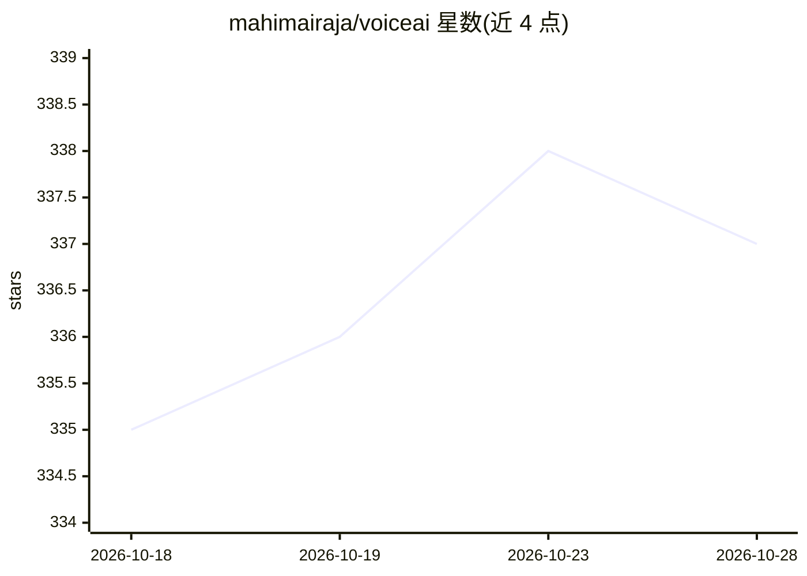

# mahimairaja/voiceai

⭐ 337 · Astro · MIT · 推送 2026-10-28 · [GitHub](https://github.com/mahimairaja/voiceai) · [官网](https://voiceai.mahimai.ca) · 个人维护 · 中文 README

**实时语音 AI agent 开发学习资源策展清单**

面向开发者的 Voice AI 学习路径清单：按基础概念、框架（LiveKit Agents/Pipecat 等）、STT/ASR、TTS 等分层组织资源，覆盖开源框架、托管平台与实时 API 的选型表格及对比评测。条目按初学者/中级/高级分级标注，优先收录免费官方文档并披露作者商业利益；另附作者撰写的付费配套书《Voice Agents Handbook》及免费样章。清单同时提供英文与中文版本。

## 筛选速览

| 维度 | 判定 | 备注 |
|---|---|---|
| AI 角色 | `ai-knowledge` | 知识聚合/清单类 |
| 许可风险 | `permissive` | MIT |
| 部署形态 | `self-host` | docker 或自建部署 |
| 模型依赖 | — | README 未给出锁定关系 |
| 硬件要求 | — | 无带数字的原话,不猜 |
| 安装摩擦 | `low` | 无编译、无系统依赖或容器化 |
| 成熟度 | — | 结构信号不足 |

## 能力要点

- 按学习路径组织：基础→框架→组件→传输→生产/评估
- 资源按 🟢初学/🟡中级/🔴高级 分级标注
- 各组件提供选型表格（开源/商业/托管平台对比）
- 披露作者商业利益并提供中英双语版本

## 适用场景

- 从零学习构建实时语音 agent 的完整技术栈
- 选型 STT/TTS/框架时查找对比资源与榜单
- 了解语音 agent 生态中的开源与托管方案

## 场景标签

`精选清单` · 领域:学习与行业

## 证据(README 行号)

> L1: Voice AI: a curated learning path for building real-time voice agents
> L3: **A curated, developer-friendly learning path for building real-time voice AI agents, from your first STT call to sc
> L16: Learning resources are tagged **🟢 Beginner**, **🟡 Intermediate**, or **🔴 Advanced** (blogs, podcasts, communities, 

## 星数曲线

2026-10-18 335 → 2026-10-28 337（+2）

---
*卡片 v1 · prompt 1.4 · 生成 2026-10-22 · 置信度 mid · 依据 README sha `2c34b0c50c47` · [字段定义](../../DATASET.md)*
