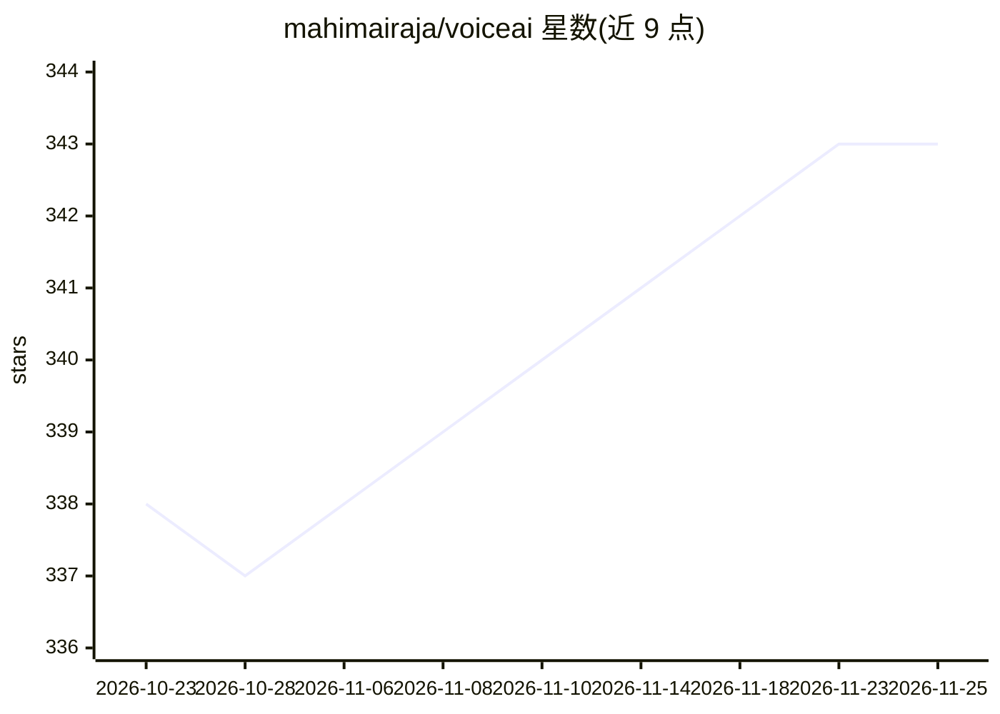

# mahimairaja/voiceai

⭐ 343 · Astro · MIT · 推送 2026-10-28 · [GitHub](https://github.com/mahimairaja/voiceai) · [官网](https://voiceai.mahimai.ca) · 个人维护 · 中文 README

**构建实时语音 AI Agent 的开发者学习资源清单**

按学习路径组织的实时语音 Agent 资源聚合清单：从基础概念（STT→LLM→TTS 流水线、延迟预算、轮次检测）到框架选型（LiveKit Agents、Pipecat 等开源框架与 Vapi、Retell 等托管平台）、再到 STT/TTS 组件、电话接入与生产化议题。资源按初/中/高级三级标注，优先收录免费官方文档并标注作者商业利益；作者另出版配套书籍《Voice Agents Handbook》并在 README 中披露利益关系。

## 筛选速览

| 维度 | 判定 | 备注 |
|---|---|---|
| AI 角色 | `ai-knowledge` | 知识聚合/清单类 |
| 许可风险 | `permissive` | MIT |
| 部署形态 | `self-host` | docker 或自建部署 |
| 模型依赖 | — | README 未给出锁定关系 |
| 硬件要求 | — | 无带数字的原话,不猜 |
| 安装摩擦 | `low` | 无编译、无系统依赖或容器化 |
| 成熟度 | — | 结构信号不足 |

## 能力要点

- 按 Foundations→Frameworks→Components→Telephony→Production 顺序组织的学习路径
- 资源标注 🟢/🟡/🔴 难度级别并披露作者商业利益
- 覆盖开源框架、托管平台、Realtime API 与 STT/TTS 组件的选型表格

## 适用场景

- 入门实时语音 Agent 开发时按路径系统学习
- 为语音 Agent 项目选型 STT、框架或托管平台时查阅资源
- 了解语音 Agent 流水线各组件（VAD、轮次检测等）的原理资料

## 场景标签

`精选清单` `教程课程` · 领域:学习与行业

## 证据(README 行号)

> L1: Voice AI: a curated learning path for building real-time voice agents
> L3: **A curated, developer-friendly learning path for building real-time voice AI agents, from your first STT call to sc
> L16: Learning resources are tagged **🟢 Beginner**, **🟡 Intermediate**, or **🔴 Advanced** (blogs, podcasts, communities, 

## 星数曲线

2026-10-23 338 → 2026-11-25 343（+5）

---
*卡片 v1 · prompt 1.4 · 生成 2026-11-25 · 置信度 mid · 依据 README sha `f7c3c35787be` · [字段定义](../../DATASET.md)*
