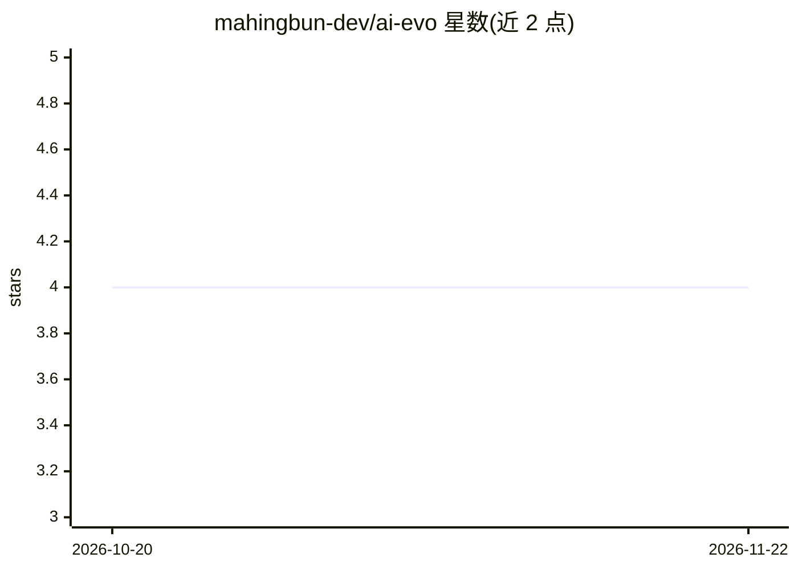

# mahingbun-dev/ai-evo

⭐ 4 · Python · Apache-2.0 · 推送 2026-10-30 · [GitHub](https://github.com/mahingbun-dev/ai-evo) · 个人维护 · 中文 README

**自托管 LLM/Agent 质量评测平台：评测即发布门禁**

面向需要为 LLM 与 Agent 建立量化评测流程的团队：提供模型端点配置、数据集管理（Excel 导入、Agent 会话导入、媒体字段）、评测前脚本库、6+ 种评测类型（AI 评审、长会话、一致性、成功率、RAG 检索指标、二分类）、结果分析与 A/B 对比。以 FastAPI + Vue 3 + Celery 构建，Docker Compose 单栈部署；首个注册用户成为超级管理员，会话用 JWT，密码 PBKDF2 哈希。描述中的发布门禁能力（API keys、CI CLI、webhooks）标注为后续里程碑（M1）交付。评测前脚本默认 local 执行模式仅限开发环境，生产须用 container 沙箱模式。

## 筛选速览

| 维度 | 判定 | 备注 |
|---|---|---|
| AI 角色 | `ai-ecosystem` | LLM/agent 周边工具 |
| 许可风险 | `permissive` | Apache-2.0 |
| 部署形态 | `self-host` | docker 或自建部署 |
| 模型依赖 | — | README 未给出锁定关系 |
| 硬件要求 | — | 无带数字的原话,不猜 |
| 安装摩擦 | `low` | 无编译、无系统依赖或容器化 |
| 成熟度 | `idea` | |

## 能力要点

- 8 种评测类型含 AI judge / Agent 长会话 / 一致性 / 成功率 / RAG 检索 / 二分类
- 数据集支持 Excel 动态字段、Agent 会话文件与媒体字段导入
- 评测前脚本库（zip/文件夹包）与在线文件树编辑、脚手架模板
- Docker Compose 单栈部署，Celery worker 执行评测任务

## 适用场景

- 上线前为 Agent 回答质量设置量化评测关卡
- 用 AI 评审模型按自定义维度批量给模型输出打分
- 对比两个模型/版本的 A/B 评测结果
- 对 RAG 系统计算精确率、召回率等检索指标

## 场景标签

`模型评测` · 领域:评测与运维

## 证据(README 行号)

> L3: Systematically and quantitatively evaluate the response quality of LLMs and Agents — model configs, dataset manageme
> L24: |Evaluation tasks|AI judge / Agent long-session / consistency / success-rate / RAG retrieval / binary classificatio

## 星数曲线

2026-10-20 4 → 2026-11-22 4（+0）

---
*卡片 v1 · prompt 1.4 · 生成 2026-11-21 · 置信度 high · 依据 README sha `854312555cfc` · [字段定义](../../DATASET.md)*
