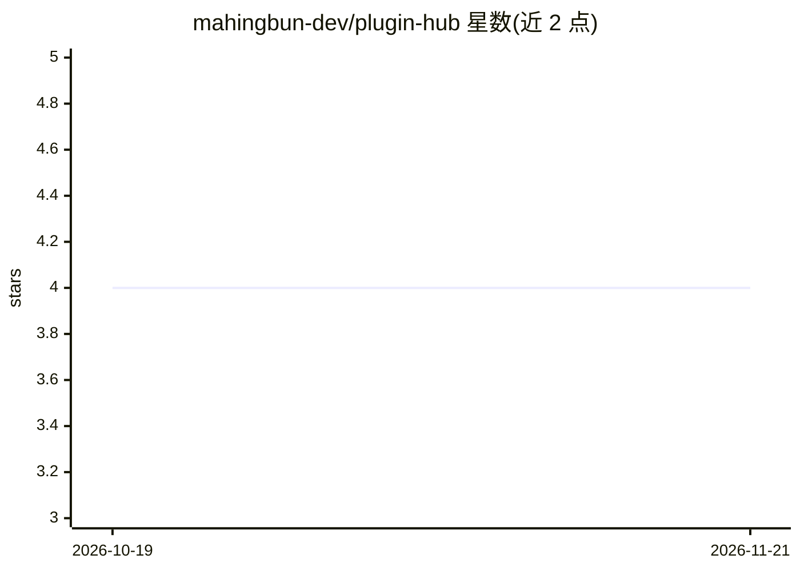

# mahingbun-dev/plugin-hub

⭐ 4 · Rust · MIT · 推送 2026-10-10 · [GitHub](https://github.com/mahingbun-dev/plugin-hub) · [官网](https://github.com/mahingbun-dev/plugin-hub/releases/latest) · 个人维护 · 中文 README

**给开发者的 Rust 进程外插件中台：注册发现、编排与 MCP 工具面**

以 Rust 实现的进程外插件架构控制中枢：核心只提供接口无业务语义，业务能力由独立容器形态的插件（gRPC 接口，默认 Go SDK，另有 Python/Node/Rust/C# SDK）提供，注册即用、无需重启中枢。关键机制包括：注册时基于 proto 描述符的字段级契约兼容性检查、DAG 声明式编排（草稿/发布两阶段）、基于 Redis Stream 的同步/异步执行链路、每实例并发上限与熔断治理、W3C trace 全链路观测，以及向 agent 聚合插件能力的 MCP 工具面（18 个内置工具）。依赖 PostgreSQL 与 Redis，附带 13 页 Web 控制台。

## 筛选速览

| 维度 | 判定 | 备注 |
|---|---|---|
| AI 角色 | `ai-ecosystem` | LLM/agent 周边工具 |
| 许可风险 | `permissive` | MIT |
| 部署形态 | `self-host` | docker 或自建部署 |
| 模型依赖 | — | README 未给出锁定关系 |
| 硬件要求 | — | 无带数字的原话,不猜 |
| 安装摩擦 | `low` | 无编译、无系统依赖或容器化 |
| 成熟度 | — | 结构信号不足 |

## 能力要点

- 注册时字段级契约兼容检查，阻断契约漂移
- 18 个内置 MCP 工具，插件能力自动聚合为单一工具面
- DAG 声明式编排，草稿/发布两阶段校验
- 五种语言 SDK 与脚手架模板一键生成

## 适用场景

- 多个业务系统需要统一接入点与契约治理
- 让 AI agent 通过单一 MCP 面调用跨系统能力
- 需要跨插件 DAG 编排与全链路追踪的微服务体系
- 插件需保持独立部署栈与发布节奏的场景

## 场景标签

`工作流自动化` `Agent 框架` · 领域:Agent 开发

## 证据(README 行号)

> L17: plugin-hub is the control hub for an out-of-process plugin architecture. The core only provides the "socket" and co
> L19: It targets this class of problem: many business systems need a single access point, contract changes need to be con
> L30: |**MCP tool surface**|18 built-in tools; plugin tools aggregate automatically (`plugin__tool`); an agent pulls `too

## 星数曲线

2026-10-19 4 → 2026-11-21 4（+0）

---
*卡片 v1 · prompt 1.4 · 生成 2026-11-21 · 置信度 mid · 依据 README sha `0c0bd957d3f5` · [字段定义](../../DATASET.md)*
