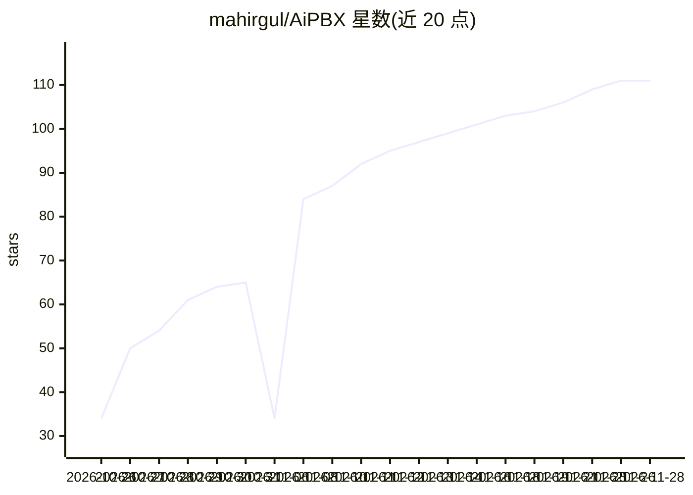

# mahirgul/AiPBX

⭐ 111 · PHP · NOASSERTION · 推送 2026-11-27 · [GitHub](https://github.com/mahirgul/AiPBX) · [官网](https://aipbx.bid) · 个人维护

**自托管企业 IP PBX 管理门户：内置 AI 语音代理与统一通信**

基于 Asterisk 22、PHP 8 与 MariaDB 的自托管电话系统管理门户，提供分机/中继/IVR/队列等 PBX 管理、呼叫中心套件、WebRTC 软电话、团队聊天、传真及 Android/iOS 应用。AI 部分：Cascade 与 Realtime 语音代理（ARI/AudioSocket 媒体通道）、支持任意 OpenAI 兼容服务器的云端 LLM、知识库 RAG、语音信箱摘要与通话评分，v1.82 起含 AI 安装向导、Silero VAD/Smart Turn 检测器与本地模型 GPU 支持。一键脚本安装于 Ubuntu/Debian，MIT 许可。

## 筛选速览

| 维度 | 判定 | 备注 |
|---|---|---|
| AI 角色 | `ai-enhanced` | 去掉 AI 部分产品仍成立 |
| 许可风险 | `none` | NOASSERTION |
| 部署形态 | `None` |  |
| 模型依赖 | — | README 未给出锁定关系 |
| 硬件要求 | — | 无带数字的原话,不猜 |
| 安装摩擦 | `low` | 无编译、无系统依赖或容器化 |
| 成熟度 | — | 结构信号不足 |

## 能力要点

- 内置 AI 语音代理（Cascade/Realtime），支持云端与任意 OpenAI 兼容 LLM 服务器及本地模型 GPU 加速
- 知识库 RAG、语音信箱摘要与通话评分
- 完整 PBX 功能：PJSIP 分机、中继、多级 IVR、队列、传真、通话录音
- WebRTC 软电话、Go 团队聊天、视频会议与 Android/iOS 原生应用

## 适用场景

- 为企业自托管一套电话系统与呼叫中心
- 为来电接入 AI 语音代理与知识库问答
- 浏览器与手机统一的通话、聊天和传真办公
- 对部署于本地网络的多品牌话机做零接触自动配置

## 场景标签

`语音 Agent` `RAG` · 领域:对话与助手

## 证据(README 行号)

> L47: Legacy open-source PBXs feel stuck in the 2000s or lock essential features behind per-seat licensing. **AiPBX** giv
> L50: - **Built-in AI Voice & Analytics** — interactive Cascade and Realtime voice agents with ARI or AudioSocket media, 

## 星数曲线

2026-10-26 34 → 2026-11-28 111（+77）

---
*卡片 v1 · prompt 1.4 · 生成 2026-11-28 · 置信度 high · 依据 README sha `74226ee8cab9` · [字段定义](../../DATASET.md)*
