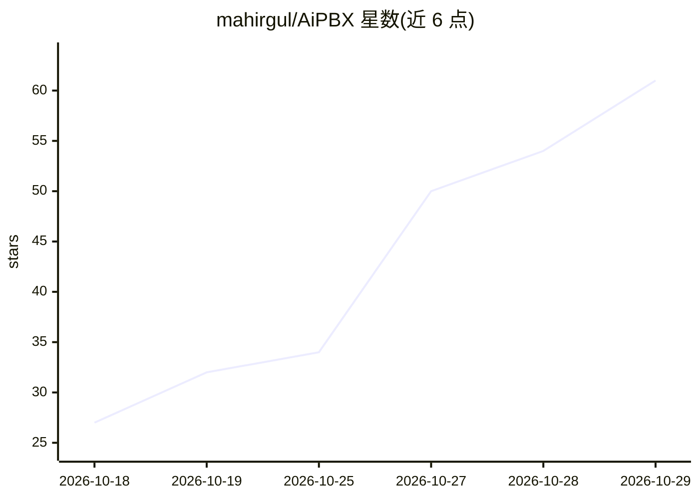

# mahirgul/AiPBX

⭐ 61 · PHP · NOASSERTION · 推送 2026-10-28 · [GitHub](https://github.com/mahirgul/AiPBX) · [官网](https://aipbx.bid) · 个人维护

**开源 IP PBX 管理门户：Asterisk 22 电话/聊天/传真/呼叫中心一体化**

基于 Asterisk 22、PHP 8、MariaDB 的自托管 IP PBX 管理门户与统一通信平台，面向企业通信场景。提供分机/中继/路由/IVR/队列管理、WebRTC 浏览器软电话、T.38 传真、呼叫中心坐席与报表、Go 聊天服务及 Android/iOS 应用。AI 为附加功能：云端 TTS（Google/Polly/Azure/ElevenLabs/OpenAI）与自然语言拨号计划助手（干跑预览、审计、一键撤销）。一键脚本安装于 Ubuntu 26.04 LTS。

## 筛选速览

| 维度 | 判定 | 备注 |
|---|---|---|
| AI 角色 | `ai-enhanced` | 去掉 AI 部分产品仍成立 |
| 许可风险 | `none` | NOASSERTION |
| 部署形态 | `None` |  |
| 模型依赖 | — | README 未给出锁定关系 |
| 硬件要求 | — | 无带数字的原话,不猜 |
| 安装摩擦 | `low` | 无编译、无系统依赖或容器化 |
| 成熟度 | — | 结构信号不足 |

## 能力要点

- PJSIP 分机、中继、路由、IVR、队列等 PBX 全功能管理
- 浏览器 WebRTC 软电话（TURNS/coturn NAT 穿越、Opus+DTLS-SRTP）
- 云端 TTS 支持多家服务商，凭据加密存储、按字符统计用量
- REST API v1（100+ 端点）、Webhook、插件系统与安全模式熔断

## 适用场景

- 企业自建电话系统并统一管理分机、中继与路由
- 搭建带坐席墙板与报表的呼叫中心
- 在浏览器和手机上接打电话、收发聊天与传真

## 场景标签

 · 领域:企业通信/VOIP

## 证据(README 行号)

> L5:  Open-Source Enterprise IP PBX Management Portal & Unified Communications
> L189: - **Cloud TTS** — turn text into speech with Google (API key or service account), Amazon Polly, Azure AI

## 星数曲线

2026-10-18 27 → 2026-10-29 61（+34）

---
*卡片 v1 · prompt 1.4 · 生成 2026-10-25 · 置信度 high · 依据 README sha `a08ebad9e0fe` · [字段定义](../../DATASET.md)*
