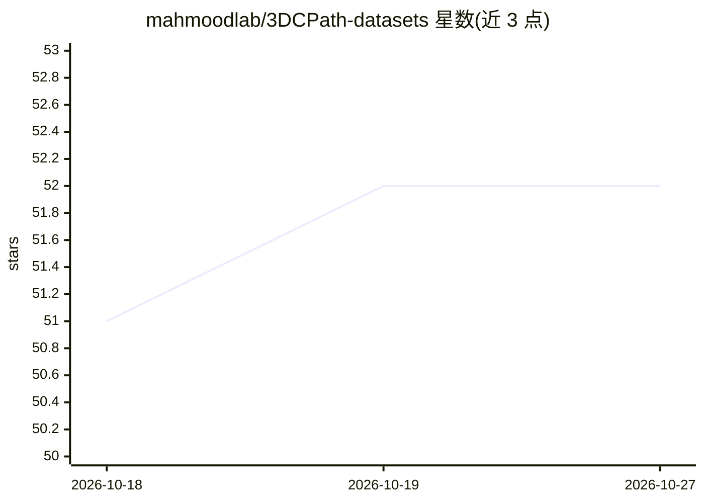

# mahmoodlab/3DCPath-datasets

⭐ 52 · 推送 2026-09-02 · [GitHub](https://github.com/mahmoodlab/3DCPath-datasets) · 组织维护

**3D 计算病理学公开数据集汇编（形态学/基因组学/联合三类）**

由 mahmoodlab 维护的 3D 计算病理学（3D CPath）公开数据集汇编清单，按三大类别组织条目：体积形态学/影像数据（如 OTLS、SRS、microCT、holotomography 等模态的 3D 组织图像）、体积基因组学数据（3D 空间转录组学、蛋白质组学、代谢组学），以及形态学与基因组学联合的体积数据。每个条目以表格记录发表期刊/日期、论文链接、模态、分辨率、器官、样本量与数据体积。仓库接受社区通过 PR 或邮件补充新数据集。

## 筛选速览

| 维度 | 判定 | 备注 |
|---|---|---|
| AI 角色 | `ai-knowledge` | 知识聚合/清单类 |
| 许可风险 | `none` | — |
| 部署形态 | `None` |  |
| 模型依赖 | — | README 未给出锁定关系 |
| 硬件要求 | — | 无带数字的原话,不猜 |
| 安装摩擦 | `low` | 无编译、无系统依赖或容器化 |
| 成熟度 | — | 结构信号不足 |

## 能力要点

- 三类组织：体积形态学影像、体积基因组学、形态+基因组联合数据
- 每个条目标注期刊、论文、模态、分辨率、器官、样本量与数据大小
- 接受社区 PR 与邮件方式贡献新数据集

## 适用场景

- 为 3D 病理深度学习研究查找公开训练/评测数据集
- 按模态（microCT、空间转录组学等）筛选合适的数据来源
- 了解 3D 计算病理学领域已公开数据集的整体覆盖情况

## 场景标签

`精选清单` · 领域:学习与行业

## 证据(README 行号)

> L1: # 3DCPath-datasets: A compilation of publicly available datasets in 3D pathology
> L3: 3DCPath-datasets is a compilation of publicly available datasets in 3D Computational Pathology (3D CPath), spanning 

## 星数曲线

2026-10-18 51 → 2026-10-27 52（+1）

---
*卡片 v1 · prompt 1.4 · 生成 2026-10-24 · 置信度 high · 依据 README sha `c3d4ed984262` · [字段定义](../../DATASET.md)*
