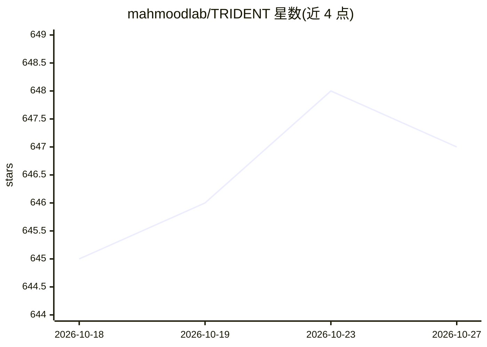

# mahmoodlab/TRIDENT

⭐ 647 · Python · NOASSERTION · 推送 2026-10-12 · [GitHub](https://github.com/mahmoodlab/TRIDENT) · [官网](https://trident-docs.readthedocs.io) · 组织维护

**病理全切片图像大规模处理工具包：分割、切块与特征提取**

由哈佛医学院 Mahmood Lab 开发的全切片图像（WSI）处理工具包，面向病理学计算研究人员。提供端到端流水线：组织分割→patch 坐标生成→patch/slide 特征提取，一条命令（--task all）或分阶段运行。支持 33 个 patch 编码器（UNI、CONCH、Virchow、GigaPath 等）与多个 slide 编码器（Titan、PRISM、CHIEF 等），支持多 GPU 分片、断点续跑、WSI 缓存流水线，并输出运行报告。安装依赖 Python 3.10/3.11 环境，通过 git clone 加 pip install -e 安装，可选装多种扩展配置；部分模型需 HuggingFace 门控访问或手动配置。

## 筛选速览

| 维度 | 判定 | 备注 |
|---|---|---|
| AI 角色 | `ai-ecosystem` | LLM/agent 周边工具 |
| 许可风险 | `none` | NOASSERTION |
| 部署形态 | `library` | 以包/库形式分发 |
| 模型依赖 | — | README 未给出锁定关系 |
| 硬件要求 | — | 无带数字的原话,不猜 |
| 安装摩擦 | `low` | 无编译、无系统依赖或容器化 |
| 成熟度 | — | 结构信号不足 |

## 能力要点

- 端到端流水线：分割→patch 坐标→patch/slide 嵌入，单命令或分阶段运行
- 33 个 patch 编码器与多个 slide 编码器（Titan、GigaPath、PRISM、CHIEF 等）
- 多 GPU 分片、按 slide 跟踪的断点续跑与锁文件保护
- 支持 OpenSlide、CuCIM、OME-Zarr、Zeiss CZI 等多种 WSI 读取格式

## 适用场景

- 对病理全切片批量提取病理基础模型特征用于下游建模
- 分阶段执行组织分割与 patch 采样并可视化质控
- 将各类格式全切片转换为金字塔 TIFF

## 场景标签

`图像视频处理` `科研工具` · 领域:学习与行业

## 证据(README 行号)

> L6: Trident is a toolkit for large-scale whole-slide image processing.
> L14: - **End-to-end pipeline**: tissue segmentation → patch coordinates → patch / slide embeddings, in one command (`--t
> L15: - **33 patch encoders**: UNI, CONCHv1.5, Virchow, Prov-GigaPath, H-Optimus-0, etc.

## 星数曲线

2026-10-18 645 → 2026-10-27 647（+2）

---
*卡片 v1 · prompt 1.4 · 生成 2026-10-21 · 置信度 high · 依据 README sha `95a46c3a3675` · [字段定义](../../DATASET.md)*
