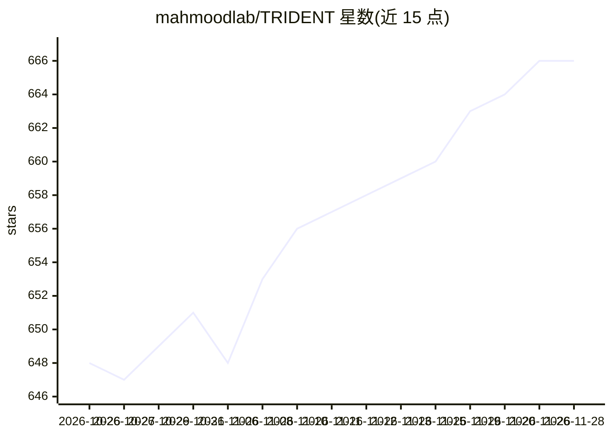

# mahmoodlab/TRIDENT

⭐ 666 · Python · NOASSERTION · 推送 2026-11-26 · [GitHub](https://github.com/mahmoodlab/TRIDENT) · [官网](https://trident-docs.readthedocs.io) · 组织维护

**病理全切片图像的大规模处理工具包，产出组织分割与特征嵌入**

由哈佛医学院 Mahmood Lab 开发的全切片图像（WSI）处理工具包，流程覆盖组织分割→patch 坐标提取→patch/slide 嵌入，可一键运行或分阶段执行。内置 34 个 patch 编码器与多个 slide 编码器，支持 OpenSlide、CuCIM、OME-Zarr、CZI、iSyntax 等多种 WSI 读取后端，提供多 GPU 分发、按切片断点续跑、本地缓存流水线与运行报告输出。面向数字病理研究人员使用。

## 筛选速览

| 维度 | 判定 | 备注 |
|---|---|---|
| AI 角色 | `ai-native` | 本体是模型或模型工具 |
| 许可风险 | `none` | NOASSERTION |
| 部署形态 | `library` | 以包/库形式分发 |
| 模型依赖 | — | README 未给出锁定关系 |
| 硬件要求 | — | 无带数字的原话,不猜 |
| 安装摩擦 | `low` | 无编译、无系统依赖或容器化 |
| 成熟度 | — | 结构信号不足 |

## 能力要点

- 34 个 patch 编码器（UNI、Virchow、Prov-GigaPath 等）与多个 slide 编码器
- 组织分割支持 HEST、GrandQC、TissueQC 及 CPU-only 的 Otsu
- 多 GPU 分发与 per-slide 断点续跑（.lock 文件与 --clear_dead_locks）
- trident-doctor 环境自检命令与多种可选依赖安装组

## 适用场景

- 批量提取病理切片的组织区域 patch 嵌入特征
- 对整片图像做组织分割并导出 GeoJSON 供 QuPath 质控
- 将普通图像/WSI 转为金字塔 TIFF

## 场景标签

`科研工具` `目标检测` · 领域:学习与行业

## 证据(README 行号)

> L6: Trident is a toolkit for large-scale whole-slide image processing.
> L14: - **End-to-end pipeline**: tissue segmentation → patch coordinates → patch / slide embeddings, in one command (`--t
> L15: - **34 patch encoders**: UNI, CONCHv1.5, Virchow, Prov-GigaPath, H-Optimus-0, etc.

## 星数曲线

2026-10-26 648 → 2026-11-28 666（+18）

---
*卡片 v1 · prompt 1.4 · 生成 2026-11-27 · 置信度 high · 依据 README sha `5ab5c1413a67` · [字段定义](../../DATASET.md)*
