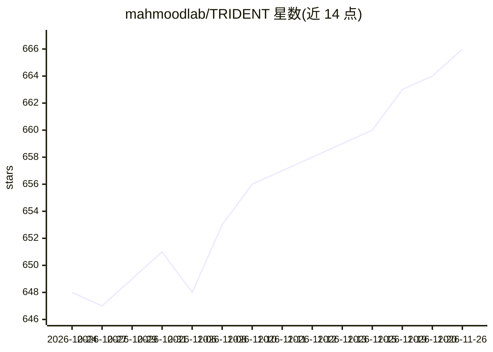

# mahmoodlab/TRIDENT

⭐ 666 · Python · NOASSERTION · 推送 2026-11-24 · [GitHub](https://github.com/mahmoodlab/TRIDENT) · [官网](https://trident-docs.readthedocs.io) · 组织维护

**病理全切片图像大规模处理的端到端工具包**

面向数字病理学研究者与开发者的全切片图像（WSI）处理工具包：一条命令串联组织分割→patch 坐标提取→patch/切片特征嵌入三个阶段，也可分步运行。内置 34 种 patch 编码器与多种切片编码器（UNI、CONCH、Virchow、GigaPath 等），支持 OpenSlide、CuCIM、OME-Zarr、Zeiss CZI、Philips iSyntax 等多种读取后端。提供多 GPU 分片、按切片断点续跑、本地 WSI 缓存管线及每次运行的摘要报告。部分模型需手动配置路径或 HuggingFace 门控审批，多数编码器许可为非商业用途。

## 筛选速览

| 维度 | 判定 | 备注 |
|---|---|---|
| AI 角色 | `ai-native` | 本体是模型或模型工具 |
| 许可风险 | `none` | NOASSERTION |
| 部署形态 | `library` | 以包/库形式分发 |
| 模型依赖 | — | README 未给出锁定关系 |
| 硬件要求 | — | 无带数字的原话,不猜 |
| 安装摩擦 | `low` | 无编译、无系统依赖或容器化 |
| 成熟度 | — | 结构信号不足 |

## 能力要点

- 端到端管线：分割→patch 坐标→嵌入，支持 --task all 一步运行
- 34 种 patch 编码器与多种切片编码器可选
- 支持多 GPU 分片与按切片断点续跑（.lock 文件保护）
- 提供 Claude Code Agent Skill，可由 AI 编码代理驱动全流程

## 适用场景

- 批量提取病理全切片的 patch/切片特征嵌入
- 对大量 WSI 做组织区域分割与质量控制（输出 GeoJSON 供 QuPath 查看）
- 将异构格式切片转换为金字塔 TIFF
- 在慢速/网络存储环境下用本地缓存加速批处理

## 场景标签

`科研工具` · 领域:学习与行业

## 证据(README 行号)

> L6: Trident is a toolkit for large-scale whole-slide image processing.
> L14: - **End-to-end pipeline**: tissue segmentation → patch coordinates → patch / slide embeddings, in one command (`--t
> L15: - **34 patch encoders**: UNI, CONCHv1.5, Virchow, Prov-GigaPath, H-Optimus-0, etc.

## 星数曲线

2026-10-24 648 → 2026-11-26 666（+18）

---
*卡片 v1 · prompt 1.4 · 生成 2026-11-24 · 置信度 high · 依据 README sha `8c885ef12605` · [字段定义](../../DATASET.md)*
