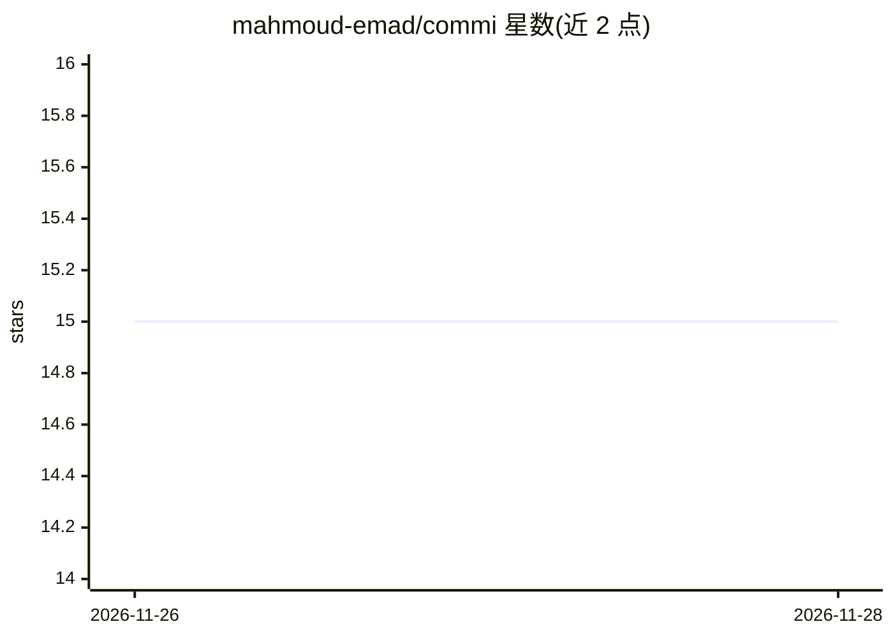

# mahmoud-emad/commi

⭐ 15 · Rust · MIT · 推送 2026-11-24 · [GitHub](https://github.com/mahmoud-emad/commi) · [官网](https://deepwiki.com/Mahmoud-Emad/commi) · 个人维护

**AI 生成 Git 提交信息的 Rust 命令行工具**

用 Rust 编写的命令行工具，读取 git diff 并调用 Google Gemini API 生成提交信息。支持单二进制安装（3.8MB，无运行时依赖），提供层级子命令、shell 补全、大 diff 分块处理，以及 AI 驱动的提交信息格式校验（遵循 Conventional Commits 规范）。模型、token 上限、分块等通过 ~/.config/commi.toml 配置，危险操作前有交互确认。需要用户提供 Google AI Studio API key。

## 筛选速览

| 维度 | 判定 | 备注 |
|---|---|---|
| AI 角色 | `ai-native` | 本体是模型或模型工具 |
| 许可风险 | `permissive` | MIT |
| 部署形态 | `None` |  |
| 模型依赖 | — | README 未给出锁定关系 |
| 硬件要求 | — | 无带数字的原话,不猜 |
| 安装摩擦 | `low` | 无编译、无系统依赖或容器化 |
| 成熟度 | — | 结构信号不足 |

## 能力要点

- 调用 Google Gemini 分析 git diff 自动生成提交信息
- 支持多个 Gemini 模型切换（gemini-1.5-flash 默认 / gemini-2.5-pro 等）
- 大 diff 分块处理与 AI 提交信息格式校验
- 单二进制约 5ms 启动，无运行时依赖

## 适用场景

- 为暂存的代码改动自动生成符合规范的提交信息
- 处理大型 diff 时分块生成提交信息
- 团队统一 Conventional Commits 提交格式

## 场景标签

`AI 写作` · 领域:内容生成

## 证据(README 行号)

> L8: **Fast, reliable, and dependency-free** - Commi is an AI-powered tool written in Rust that automatically generates G
> L12: - **AI-powered commit messages** - Uses Google's Gemini AI to analyze git diffs

## 星数曲线

2026-11-26 15 → 2026-11-28 15（+0）

---
*卡片 v1 · prompt 1.4 · 生成 2026-11-26 · 置信度 high · 依据 README sha `4c441040ab1a` · [字段定义](../../DATASET.md)*
