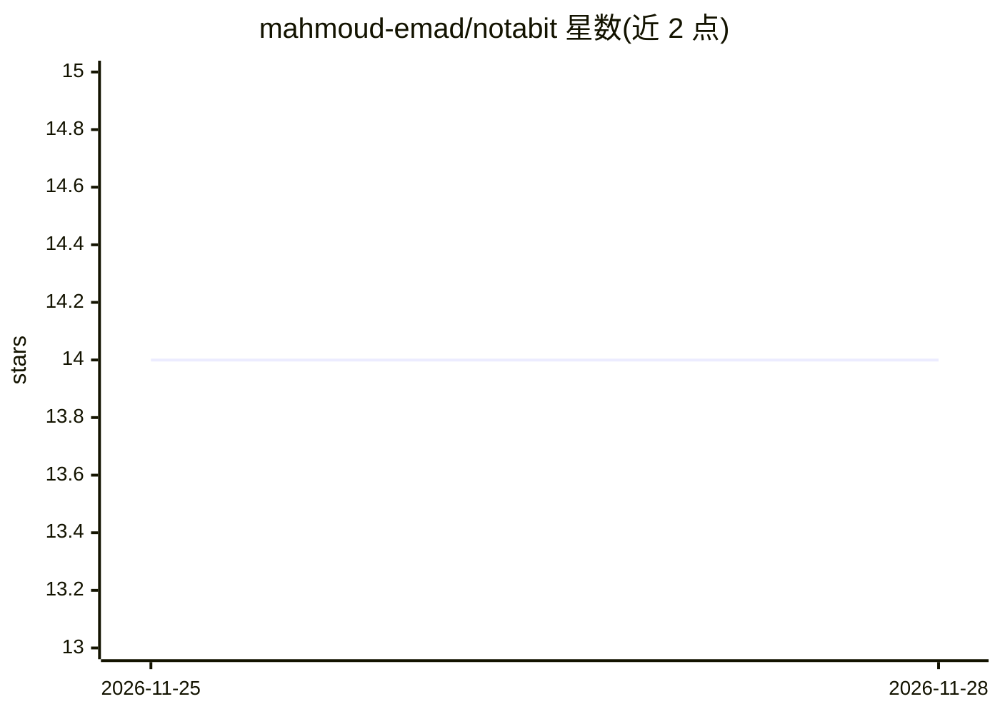

# mahmoud-emad/notabit

⭐ 14 · Python · MIT · 推送 2026-11-26 · [GitHub](https://github.com/mahmoud-emad/notabit) · [官网](https://mahmoud-emad.github.io/notabit/) · 个人维护

**自托管的开源 NotebookLM 替代：把资料变成带引用的解说课件与音视频概览**

自托管学习工作室：将 PDF、网页、YouTube 视频、录音等来源汇入集合，生成带旁白幻灯片、视频/音频概览、思维导图、学习笔记和带引用的问答。每条内容链接回原文以便核查。技术栈为 FastAPI + Postgres/pgvector + React，Docker Compose 部署，支持接入多家 LLM 供应商或本地模型，并可完全离线运行。同时以 MCP server 形式暴露集合读取与引用问答能力，供外部 agent 调用。MIT 许可。

## 筛选速览

| 维度 | 判定 | 备注 |
|---|---|---|
| AI 角色 | `ai-native` | 本体是模型或模型工具 |
| 许可风险 | `permissive` | MIT |
| 部署形态 | `self-host` | docker 或自建部署 |
| 模型依赖 | local-ok | 支持本地模型 |
| 硬件要求 | — | 无带数字的原话,不猜 |
| 安装摩擦 | `low` | 无编译、无系统依赖或容器化 |
| 成熟度 | — | 结构信号不足 |

## 能力要点

- 从多类来源生成旁白课件、视频/音频概览、思维导图与笔记
- 每条回答与生成内容均链接回原文引用
- BYOK 多供应商接入，支持 Ollama/LM Studio 全离线运行
- 内置 MCP server，agent 可列出集合、添加来源并提出引用问答

## 适用场景

- 把论文或教材 PDF 转成可提问的带引用学习资料
- 生成音频/视频概览用于复习
- 在本地离线环境下处理私人资料
- 让自有 agent 通过 MCP 读取资料集并提问

## 场景标签

`语音合成` `文档问答` · 领域:内容生成

## 证据(README 行号)

> L3: **The open-source, self-hosted NotebookLM alternative.**
> L24: Put your sources into a collection: PDFs, Office files, web links, YouTube videos, audio and video recordings (tran
> L42: - **Any model.** Bring your own key for OpenRouter, OpenAI, Anthropic, Gemini, Azure OpenAI, Mistral, Groq, DeepSee

## 星数曲线

2026-11-25 14 → 2026-11-28 14（+0）

---
*卡片 v1 · prompt 1.4 · 生成 2026-11-24 · 置信度 high · 依据 README sha `db05a51656ae` · [字段定义](../../DATASET.md)*
