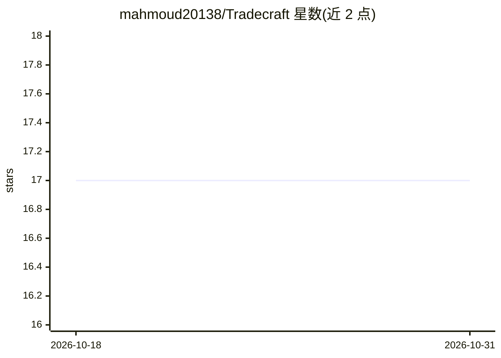

# mahmoud20138/Tradecraft

⭐ 17 · Python · MIT · 推送 2026-04-23 · [GitHub](https://github.com/mahmoud20138/Tradecraft) · 个人维护

**Claude Code 技能合集：169 个技能+5 个入口命令覆盖交易与开发**

面向 Claude Code 用户的插件化技能集合：169 个 Markdown 知识库技能（含可执行代码块、YAML 触发关键词、交叉引用），按交易（104 个）、软件工程、Claude Code 平台、AI 开发、数据采集等域组织；上层提供 5 个入口命令（analyze/search/markets/recommendations/strategies）做路由，技能仍可 /tradecraft:<name> 直接调用。以 Claude 插件市场方式安装，免费行情路径基于 yfinance 跨平台可用，可选 MT5 升级路径仅限 Windows。

## 筛选速览

| 维度 | 判定 | 备注 |
|---|---|---|
| AI 角色 | `ai-knowledge` | 知识聚合/清单类 |
| 许可风险 | `permissive` | MIT |
| 部署形态 | `library` | 以包/库形式分发 |
| 模型依赖 | — | README 未给出锁定关系 |
| 硬件要求 | — | 无带数字的原话,不猜 |
| 安装摩擦 | `low` | 无编译、无系统依赖或容器化 |
| 成熟度 | — | 结构信号不足 |

## 能力要点

- 169 个自包含技能：领域知识+可执行代码+触发关键词+交叉引用
- 5 个入口命令覆盖全集合，同时保留逐技能直接调用
- 免费行情路径基于 yfinance，无需账号与 API key
- 跨平台（Windows/macOS/Linux），MT5 可选路径限 Windows

## 适用场景

- 在 Claude Code 中做行情分析、盯盘快照与交易策略深挖
- 按关键词检索定位所需专项技能
- 复用软件工程、Claude Code 插件开发等通用技能

## 场景标签

`金融量化` · 领域:学习与行业

## 证据(README 行号)

> L3: > **5 entry-point commands** on top of **169 curated AI skills** — trading, AI development, software engineering, Cl
> L72: Each skill is a self-contained Markdown knowledge base with:
> L75: - **Trigger keywords** — YAML frontmatter so Claude auto-selects the right skill

## 星数曲线

2026-10-18 17 → 2026-10-31 17（+0）

---
*卡片 v1 · prompt 1.4 · 生成 2026-10-29 · 置信度 mid · 依据 README sha `ef3bc5702ec9` · [字段定义](../../DATASET.md)*
