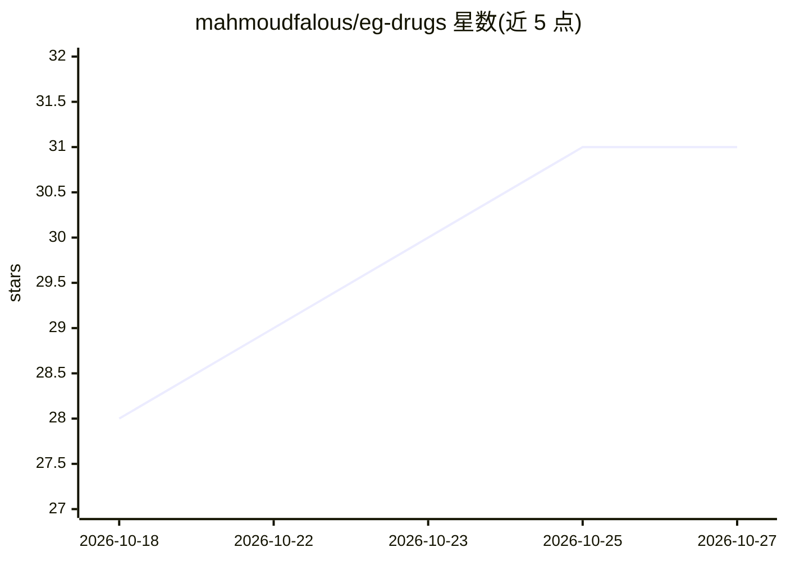

# mahmoudfalous/eg-drugs

⭐ 31 · MIT · 推送 2026-10-04 · [GitHub](https://github.com/mahmoudfalous/eg-drugs) · 个人维护

**埃及药品数据集：26,562 条药品记录含 FDA 映射与阿拉伯语信息**

包含 26,562 条埃及市售药品记录的数据集，提供 CSV（约 22.1 MB）与 JSON（约 36.5 MB）两种 UTF-8 格式。字段覆盖英文与阿拉伯语药名、活性成分、厂商、现价与旧价、条码，以及基于 FDA 成分信息自动生成的 7 类安全警示标志（高血压、糖尿病、妊娠、哺乳、肾、肝、心脏）和阿/英双语用途摘要。README 给出 Python、Pandas 与 SQL 的加载与查询示例，适用于药房系统、药品搜索引擎、AI 医疗助手与学术研究。许可条款部分内容在可见范围内未完整展示。

## 筛选速览

| 维度 | 判定 | 备注 |
|---|---|---|
| AI 角色 | `ai-knowledge` | 知识聚合/清单类 |
| 许可风险 | `permissive` | MIT |
| 部署形态 | `None` |  |
| 模型依赖 | — | README 未给出锁定关系 |
| 硬件要求 | — | 无带数字的原话,不猜 |
| 安装摩擦 | `low` | 无编译、无系统依赖或容器化 |
| 成熟度 | — | 结构信号不足 |

## 能力要点

- 26,562 条药品记录，阿英双语字段
- FDA 成分映射与 7 类安全警示标志（0/1 取值）
- CSV 与 JSON 双格式，UTF-8 编码
- 提供 Python/Pandas/SQL 加载与查询示例

## 适用场景

- 我需要为药房管理系统或药品搜索引擎导入埃及药品基础数据
- 我在做阿拉伯语医疗 NLP 或 AI 医疗助手，需要结构化药品语料
- 我想按病症警示（如妊娠、糖尿病）筛选药品做分析或研究

## 场景标签

 · 领域:医疗健康/药品数据

## 证据(README 行号)

> L3: A comprehensive, FDA-enriched pharmaceutical dataset containing **26,562 drugs marketed in Egypt**, including active
> L15: |Formats Available|CSV, JSON|

## 星数曲线

2026-10-18 28 → 2026-10-27 31（+3）

---
*卡片 v1 · prompt 1.4 · 生成 2026-10-26 · 置信度 high · 依据 README sha `90e7752a6109` · [字段定义](../../DATASET.md)*
