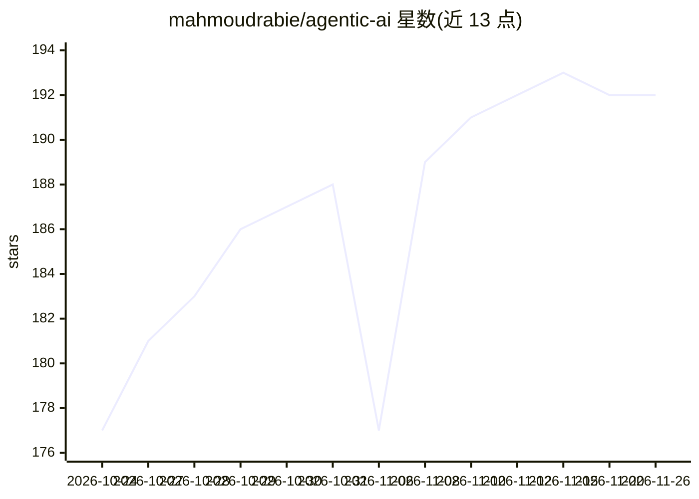

# mahmoudrabie/agentic-ai

⭐ 192 · MIT · 推送 2026-11-22 · [GitHub](https://github.com/mahmoudrabie/agentic-ai) · 个人维护

**面向研究者与开发者的 Agentic AI 论文/基准/框架策展清单**

以 awesome-list 形式收录 300+ 条 Agentic AI 资源，涵盖论文、基准、框架与真实系统，组织为 24 个领域（框架 69、研究 67、安全 60、测试 27 等），并按机构统计论文归属分布（Stanford 27、UIUC 26 等）。为构建者与研究者提供导航路径，按研究、工程、行业应用等维度建议浏览顺序。MIT 许可，接受 PR 贡献。

## 筛选速览

| 维度 | 判定 | 备注 |
|---|---|---|
| AI 角色 | `ai-knowledge` | 知识聚合/清单类 |
| 许可风险 | `permissive` | MIT |
| 部署形态 | `None` |  |
| 模型依赖 | — | README 未给出锁定关系 |
| 硬件要求 | — | 无带数字的原话,不猜 |
| 安装摩擦 | `low` | 无编译、无系统依赖或容器化 |
| 成熟度 | — | 结构信号不足 |

## 能力要点

- 300+ 条资源覆盖 24 个领域
- 按机构/公司统计论文归属分布
- 提供按研究方向的分类浏览路径
- MIT 许可，接受社区 PR 贡献

## 适用场景

- 查找构建 agent 的框架与编排模式资源
- 检索安全、红队与评测基准论文
- 了解各机构在 Agentic AI 领域的研究分布

## 场景标签

`精选清单` · 领域:学习与行业

## 证据(README 行号)

> L10: **300+ curated agentic AI papers, benchmarks, frameworks, and real-world systems across 24 domains.**
> L39: |⚙️ Framework|69|Agent runtimes, memory, tools, orchestration|

## 星数曲线

2026-10-24 177 → 2026-11-26 192（+15）

---
*卡片 v1 · prompt 1.4 · 生成 2026-11-25 · 置信度 high · 依据 README sha `30c65eddeb54` · [字段定义](../../DATASET.md)*
