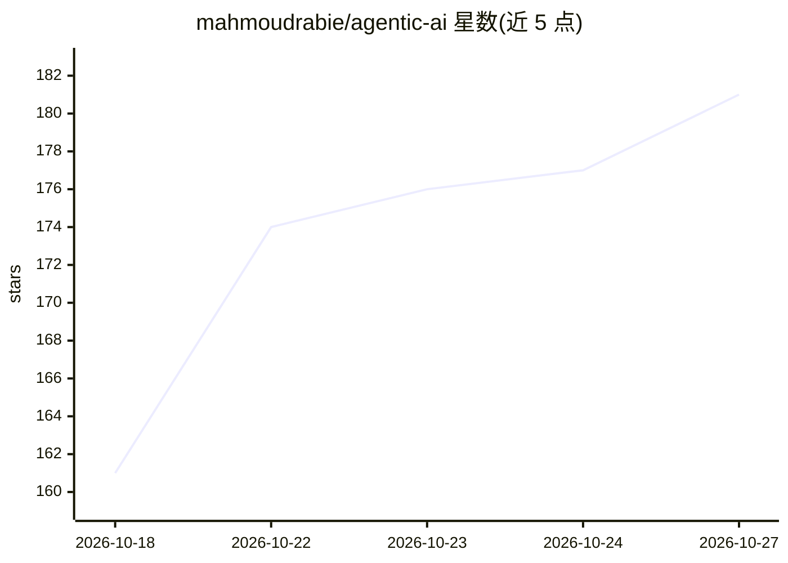

# mahmoudrabie/agentic-ai

⭐ 181 · MIT · 推送 2026-10-26 · [GitHub](https://github.com/mahmoudrabie/agentic-ai) · 个人维护

**Agentic AI 研究资源策展清单（300+ 条，24 领域）**

由个人维护的 Agentic AI 资源聚合仓库，收录 300+ 篇论文、基准、框架与真实系统条目，按 24 个领域组织：Research（65 条）、Framework（64 条）、Security（54 条）、Reasoning、Testing、Healthcare、Software Engineering 等，覆盖从认知基础到行业应用。提供 5 条建议浏览路径（核心认知/工程框架/行业/硬件/生态伦理），并规定策展标准：主链接指向论文、代码库、基准或项目页，社交帖子仅作次级链接，资源须放入最相关领域并去重。通过 PR 接受贡献。

## 筛选速览

| 维度 | 判定 | 备注 |
|---|---|---|
| AI 角色 | `ai-knowledge` | 知识聚合/清单类 |
| 许可风险 | `permissive` | MIT |
| 部署形态 | `None` |  |
| 模型依赖 | — | README 未给出锁定关系 |
| 硬件要求 | — | 无带数字的原话,不猜 |
| 安装摩擦 | `low` | 无编译、无系统依赖或容器化 |
| 成熟度 | — | 结构信号不足 |

## 能力要点

- 300+ 条资源覆盖 24 个领域，含论文、基准、框架与真实系统
- Research/Framework/Security 为条目数最多的三个领域（65/64/54 条）
- 明确的策展标准：主链接指向论文或代码库，避免重复
- 提供面向不同关注点（认知、工程、行业、硬件、伦理）的建议浏览路径

## 适用场景

- 查找构建 agent 所需的框架与编排模式资料
- 调研 agent 的评测、测试与基准资源
- 按领域（医疗、安全、机器人等）查找应用案例与安全治理研究

## 场景标签

`精选清单` · 领域:学习与行业

## 证据(README 行号)

> L10: **300+ curated agentic AI papers, benchmarks, frameworks, and real-world systems across 24 domains.**
> L37: |Domain|Researches|Focus|

## 星数曲线

2026-10-18 161 → 2026-10-27 181（+20）

---
*卡片 v1 · prompt 1.4 · 生成 2026-10-22 · 置信度 high · 依据 README sha `969ffa26cff7` · [字段定义](../../DATASET.md)*
