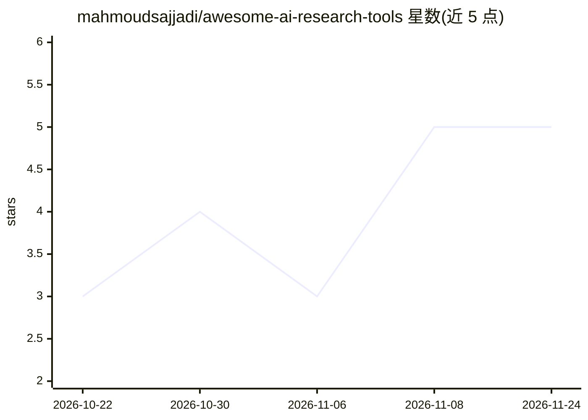

# mahmoudsajjadi/awesome-ai-research-tools

⭐ — · [GitHub]() · 个人维护

**科研人员的 AI 科研工具策展清单：文献、写作、复现**

由 Mahmoud Sajjadi 维护的科研 AI 工具清单，按科研生命周期组织为八个板块：文献发现与语义检索、引文图谱、论文阅读与综合、LaTeX 写作与学术润色、实验跟踪与 MLOps、论文到代码复现、科研绘图、自主科研 Agent。附工具对比矩阵（开源/自托管/成本）、出版商 AI 披露合规清单、Zotero 与 LaTeX 指南链接，以及维护者本人的论文列表与 BibTeX 引用条目。

## 筛选速览

| 维度 | 判定 | 备注 |
|---|---|---|
| AI 角色 | `ai-knowledge` | 知识聚合/清单类 |
| 许可风险 | `permissive` | — |
| 部署形态 | `None` |  |
| 模型依赖 | — | README 未给出锁定关系 |
| 硬件要求 | — | 无带数字的原话,不猜 |
| 安装摩擦 | `low` | 无编译、无系统依赖或容器化 |
| 成熟度 | — | 结构信号不足 |

## 能力要点

- 按文献发现→引文综合→LaTeX 写作→MLOps 复现的科研全生命周期组织
- 提供 12 个工具的开源/自托管/成本对比矩阵
- 附 Elsevier、Springer-Nature、IEEE、ACM 的生成式 AI 披露合规清单
- 含文献发现、引文图谱、自主科研 Agent 等八个分类

## 适用场景

- 为文献综述寻找语义检索与引文分析工具
- 挑选实验跟踪与可复现性平台
- 查找公式截图转 LaTeX、学术润色类工具
- 了解自主科研 Agent 的现有选项

## 场景标签

`精选清单` `科研工具` · 领域:学习与行业

## 证据(README 行号)

> L3: > **`awesome-ai-research-tools`** is the authoritative, curated catalog of state-of-the-art **Awesome AI Research To
> L14: - **End-to-End Scientific Lifecycle:** Structured across the full lifecycle: literature discovery $\rightarrow$ cit
> L31: ## 🔍 Literature Discovery & Semantic Search

## 星数曲线

2026-10-22 3 → 2026-11-24 5（+2）

---
*卡片 v1 · prompt 1.4 · 生成 2026-11-21 · 置信度 high · 依据 README sha `de33f0c0489e` · [字段定义](../../DATASET.md)*
