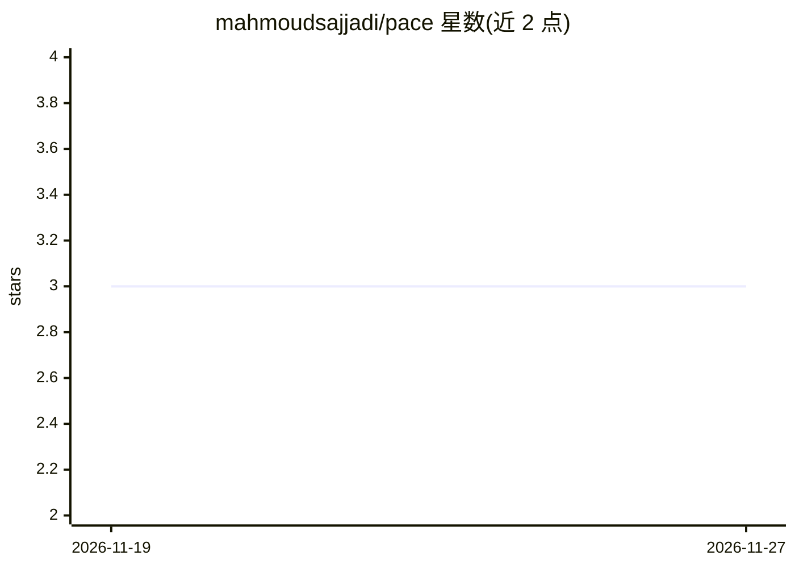

# mahmoudsajjadi/pace

⭐ 3 · Python · Apache-2.0 · 推送 2026-11-25 · [GitHub](https://github.com/mahmoudsajjadi/pace) · [官网](https://huggingface.co/spaces/sajjadi/pace-studio) · 个人维护

**面向研究者的多智能体 LLM 算力对齐评测工具包**

论文复现仓库与评测工具包：对多智能体 LLM 评测做基线分级（A–D 四类）、六维资源向量核算与 token 对齐审计，输出对比账本、前沿差距与报告卡；内置 pace CLI（审计/分类/模拟/元分析命令）与零依赖浏览器工作台 PACE Studio，支持导入 Inspect AI 格式日志。受控实验经 Ollama 运行 llama3.1:8b，在单张 12GB 消费级显卡可复现；代码 Apache-2.0、数据 CC-BY-4.0，需 Python 3.10+。

## 筛选速览

| 维度 | 判定 | 备注 |
|---|---|---|
| AI 角色 | `ai-ecosystem` | LLM/agent 周边工具 |
| 许可风险 | `permissive` | Apache-2.0 |
| 部署形态 | `library` | 以包/库形式分发 |
| 模型依赖 | local-ok | 支持本地模型 |
| 硬件要求 | — | 无带数字的原话,不猜 |
| 安装摩擦 | `low` | 无编译、无系统依赖或容器化 |
| 成熟度 | — | 结构信号不足 |

## 能力要点

- 四类基线分级与六维资源向量核算的多智能体评测框架
- pace CLI 提供审计、分类、模拟、元分析与前沿差距计算
- PACE Studio 零依赖浏览器工作台，支持 Inspect AI 日志导入
- 单张 12GB 显卡上的可复现受控实验脚本

## 适用场景

- 审计自己多智能体系统的评测日志，检查基线是否算力对齐
- 按 PACE 报告卡标准撰写多智能体对比实验
- 在消费级 GPU 上复现论文中的受控对比实验

## 场景标签

`模型评测` `科研工具` · 领域:评测与运维

## 证据(README 行号)

> L23: Official replication repository, audited contrast ledger (`9` primary studies, `516` unique multi-agent configurati
> L66: Core auditing, reporting, log import (including Inspect AI via `--format inspect`), and local GUI commands:

## 星数曲线

2026-11-19 3 → 2026-11-27 3（+0）

---
*卡片 v1 · prompt 1.4 · 生成 2026-11-21 · 置信度 high · 依据 README sha `358fcccb1ff9` · [字段定义](../../DATASET.md)*
