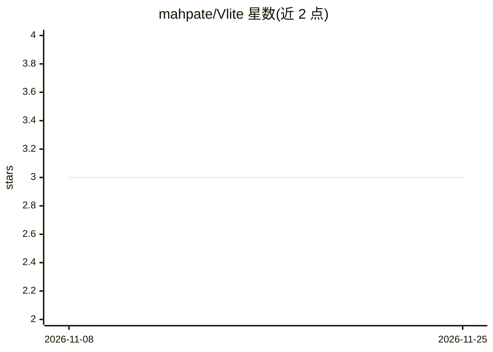

# mahpate/Vlite

⭐ 3 · Rust · MIT · 推送 2026-11-22 · [GitHub](https://github.com/mahpate/Vlite) · [官网](https://mahpate.github.io/Vlite/) · 个人维护

**给嵌入检索应用的 Rust 单文件向量与图数据库**

VLite 以单个 .vlite 文件承载向量、元数据与属性图，可作为嵌入式库（Rust/Python/Node/C ABI）使用，也可经 vlite-server 以 REST、gRPC 与浏览器 Dashboard 自托管。提供精确检索与 HNSW 近似检索、带类型元数据过滤、原子批量写入（单次提交至多 4,096 条）、多租户与角色权限、Prometheus 指标、Docker 镜像与 Helm chart。数据集驻留内存，打开时回放文件；单进程写入；pre-1.0，格式与 API 可能变动。

## 筛选速览

| 维度 | 判定 | 备注 |
|---|---|---|
| AI 角色 | `ai-ecosystem` | LLM/agent 周边工具 |
| 许可风险 | `permissive` | MIT |
| 部署形态 | `desktop` | 安装包/桌面程序 |
| 模型依赖 | — | README 未给出锁定关系 |
| 硬件要求 | — | 无带数字的原话,不猜 |
| 安装摩擦 | `low` | 无编译、无系统依赖或容器化 |
| 成熟度 | `idea` | |

## 能力要点

- 单文件持久化：校验和提交、原子批次写入、可选加密与时间点恢复
- 精确检索（L2/余弦/内积）与 HNSW 近似检索（L2/余弦），支持稀疏与命名向量及混合检索
- 内置属性图：节点、类型化边、与向量记录链接，有界遍历
- 自托管服务器带多租户、角色权限、REST/OpenAPI/gRPC 与 Web Dashboard

## 适用场景

- 为 RAG 应用提供本地嵌入向量存储与相似度检索
- 在同一文件里同时管理向量与属性图数据
- 需要多租户隔离的向量检索服务部署
- 在 Rust/Python/Node 应用中以嵌入式库方式离线运行向量检索

## 场景标签

`向量数据库` · 领域:知识与检索

## 证据(README 行号)

> L3: VLite is a single-file vector and graph database. Embed it in your
> L34:  key-value operations, opt-in agent memory with read-only shared scopes and

## 星数曲线

2026-11-08 3 → 2026-11-25 3（+0）

---
*卡片 v1 · prompt 1.4 · 生成 2026-11-21 · 置信度 high · 依据 README sha `fd09d3a8b982` · [字段定义](../../DATASET.md)*
