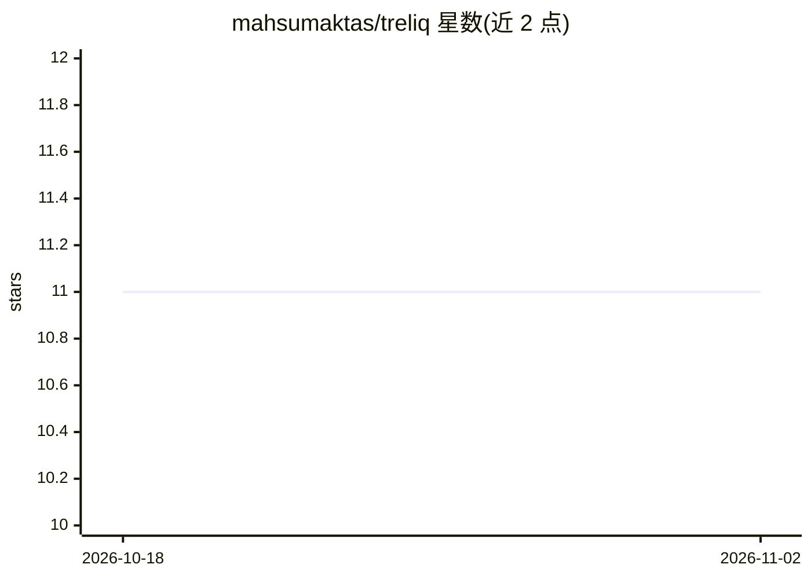

# mahsumaktas/treliq

⭐ 11 · TypeScript · MIT · 推送 2026-03-02 · [GitHub](https://github.com/mahsumaktas/treliq) · [官网](https://mahsumaktas.github.io/treliq/) · 个人维护

**维护者用的 AI PR/Issue 分诊：去重、评分、排序**

面向开源维护者与企业团队的 PR 与 issue 分诊工具，以 CLI、Fastify REST 服务器和 GitHub Action 三种形式提供。对 PR 与 issue 计算 21+12 种信号（CI 状态、测试覆盖率、垃圾检测、贡献者信任等），输出 ideaScore/implementationScore/readinessScore 双轨评分，跨 PR 与 issue 做同一向量空间的 LLM 验证去重聚类，并支持自动关闭重复/垃圾、自动合并与按意图打标签（默认 dry-run）。多 LLM 供应商（Gemini/OpenAI/Anthropic/OpenRouter），也可 --no-llm 纯启发式零成本运行。

## 筛选速览

| 维度 | 判定 | 备注 |
|---|---|---|
| AI 角色 | `ai-native` | 本体是模型或模型工具 |
| 许可风险 | `permissive` | MIT |
| 部署形态 | `library` | 以包/库形式分发 |
| 模型依赖 | — | README 未给出锁定关系 |
| 硬件要求 | — | 无带数字的原话,不猜 |
| 安装摩擦 | `low` | 无编译、无系统依赖或容器化 |
| 成熟度 | — | 结构信号不足 |

## 能力要点

- 21 个 PR 信号 + 12 个 issue 信号的启发式与 LLM 级联评分
- PR 与 issue 同一向量空间的 LLM 验证跨类型去重
- 自动关闭重复/垃圾、自动合并、按意图打标签（默认 dry-run）
- 四种 LLM 供应商可选，--no-llm 零 API 调用模式

## 适用场景

- 按评分排序找出今天最该评审的 PR
- 自动识别并关闭重复 PR 与垃圾 issue
- 在 GitHub Action 或自托管服务器中持续运行分诊

## 场景标签

`代码审查` · 领域:编码与开发

## 证据(README 行号)

> L12: Treliq scores, deduplicates, and ranks pull requests **and** issues so maintainers focus on what matters. Available
> L51: - **Cascade Pipeline** — Heuristic pre-filter -> Haiku -> Sonnet. ~$13 for 4000 PRs (vs $27 Sonnet-only)
> L55: - **Multi-Provider LLM** — Gemini (free), OpenAI, Anthropic, OpenRouter (200+ models)

## 星数曲线

2026-10-18 11 → 2026-11-02 11（+0）

---
*卡片 v1 · prompt 1.4 · 生成 2026-11-02 · 置信度 high · 依据 README sha `89884844fcf6` · [字段定义](../../DATASET.md)*
