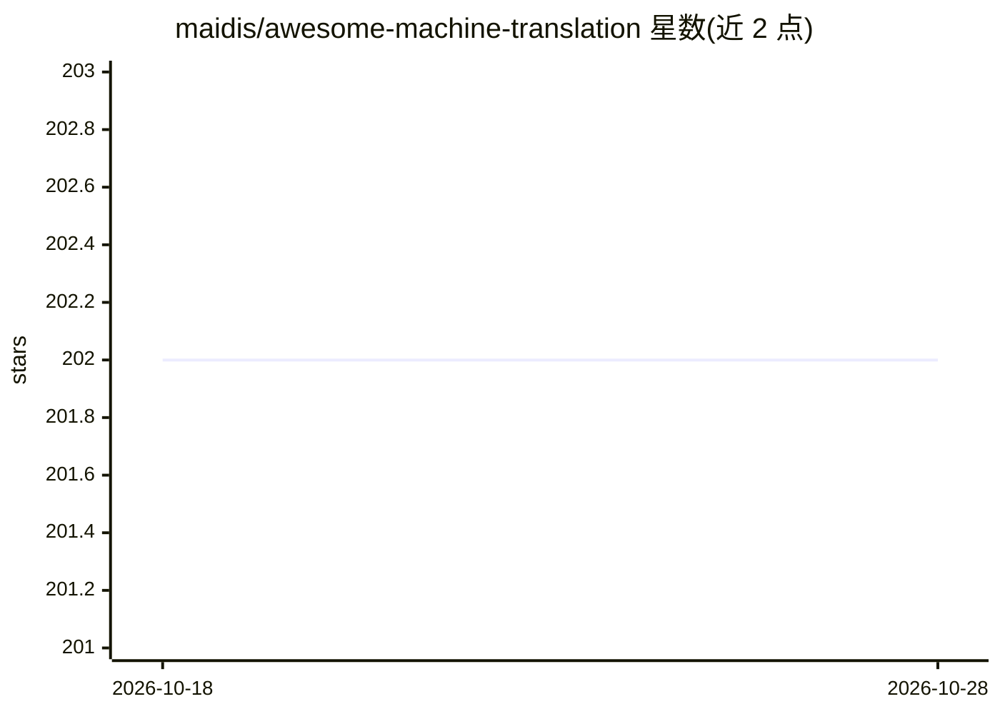

# maidis/awesome-machine-translation

⭐ 202 · CC0-1.0 · 推送 2026-10-07 · [GitHub](https://github.com/maidis/awesome-machine-translation) · 个人维护

**机器翻译框架、库、软件与论文的策展清单**

面向机器翻译研究与实践者的 awesome 清单：按对齐工具、应用、书籍、公司与付费服务、框架、在线翻译服务、组织与会议、其他清单、论文、平行语料、工具、教程等类别组织条目，收录 Bleualign、Argos Translate、fairseq、OpenNMT、Marian、Moses 等项目，并说明条目弃用标准（明确不再维护或 2~3 年无提交）。清单以 Markdown 维护，通过 pull request 接受贡献。

## 筛选速览

| 维度 | 判定 | 备注 |
|---|---|---|
| AI 角色 | `ai-knowledge` | 知识聚合/清单类 |
| 许可风险 | `viral` | CC0-1.0 |
| 部署形态 | `None` |  |
| 模型依赖 | — | README 未给出锁定关系 |
| 硬件要求 | — | 无带数字的原话,不猜 |
| 安装摩擦 | `low` | 无编译、无系统依赖或容器化 |
| 成熟度 | — | 结构信号不足 |

## 能力要点

- 按约 14 个类别组织机器翻译相关条目
- 覆盖对齐工具、NMT/SMT 框架、应用、语料与教程
- 声明条目弃用标准（停止维护或长期无提交）
- 链接外部更新清单 machinetranslate.org

## 适用场景

- 为翻译项目挑选开源机器翻译框架或库
- 查找平行语料与语料清洗工具
- 了解机器翻译领域的书籍与论文资源

## 场景标签

`精选清单` · 领域:学习与行业

## 证据(README 行号)

> L1: # Awesome Machine Translation Awesome
> L2: A list of awesome Machine Translation frameworks, libraries, software and papers. Inspired by awesome-machine-learni

## 星数曲线

2026-10-18 202 → 2026-10-28 202（+0）

---
*卡片 v1 · prompt 1.4 · 生成 2026-10-22 · 置信度 high · 依据 README sha `359e702cac42` · [字段定义](../../DATASET.md)*
