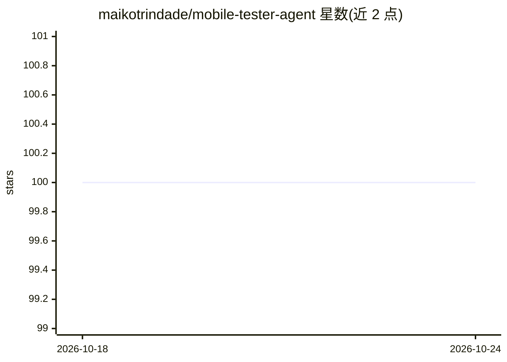

# maikotrindade/mobile-tester-agent

⭐ 100 · Kotlin · MIT · 推送 2026-05-28 · [GitHub](https://github.com/maikotrindade/mobile-tester-agent) · [官网](https://maikotrindade.com/ai/kotlin/android/development/agents/2025/08/19/building-agentic-ai-mobile-tester-koog-kotlin.html) · 个人维护

**用自然语言驱动 Android/iOS 真机自动测试的 LLM agent 工具**

面向移动开发者的 UI 测试自动化工具：开发者以自然语言编写测试场景，Kotlin/Ktor 服务端接收后由 Koog 框架的 AIAgent 逐步推理，经平台感知工具层（ADB/UiAutomator）驱动真实设备或模拟器执行测试；附带 React + Vite 的 Web 仪表盘（含 i18n 与 Firestore）。支持 Android、iOS 与 React Native 应用，LLM 可接 DeepSeek、Gemini、Claude、OpenRouter 或本地 Ollama。运行需 JDK 21、Android Platform Tools 与至少一个 LLM API key。

## 筛选速览

| 维度 | 判定 | 备注 |
|---|---|---|
| AI 角色 | `ai-native` | 本体是模型或模型工具 |
| 许可风险 | `permissive` | MIT |
| 部署形态 | `None` |  |
| 模型依赖 | local-ok | 支持本地模型 |
| 硬件要求 | — | 无带数字的原话,不猜 |
| 安装摩擦 | `medium` | 含编译或系统依赖之一 |
| 成熟度 | — | 结构信号不足 |

## 能力要点

- 自然语言编写测试场景，Koog AIAgent 驱动真机/模拟器执行
- 覆盖 Android、iOS、React Native 三类应用
- React 19 + Vite Web 仪表盘，含 HTTP API（run-test/stop-test/config）
- LLM 后端可选 DeepSeek/Gemini/Claude/OpenRouter/本地 Ollama

## 适用场景

- 用自然语言描述场景自动跑移动端 UI 回归测试
- 在真机或模拟器上验证 React Native 应用行为
- 通过 Web 仪表盘配置应用标识并触发测试

## 场景标签

`GUI 自动化` · 领域:效率与自动化

## 证据(README 行号)

> L13: AI-powered UI test automation for **Android, iOS, and React Native** — author scenarios in natural language, let a 
> L42: A Kotlin/Ktor server receives a scenario, a Koog `AIAgent` reasons step-by-step, and a platform-aware tool layer dr
> L19: **Prerequisites:** JDK 21, Android Platform Tools (`adb`), Node 18+ for the dashboard, one LLM API key (DeepSeek, G

## 星数曲线

2026-10-18 100 → 2026-10-24 100（+0）

---
*卡片 v1 · prompt 1.4 · 生成 2026-10-23 · 置信度 high · 依据 README sha `ad05ba4cdc09` · [字段定义](../../DATASET.md)*
