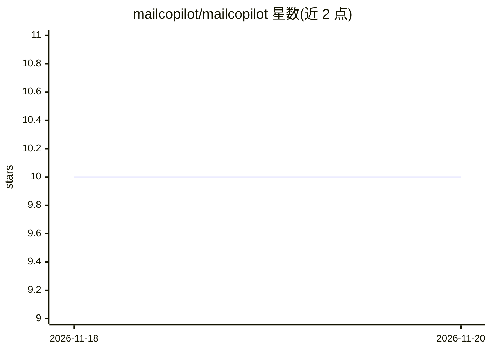

# mailcopilot/mailcopilot

⭐ 10 · TypeScript · AGPL-3.0 · 推送 2026-11-13 · [GitHub](https://github.com/mailcopilot/mailcopilot) · [官网](https://mailcopilot.io) · 组织维护

**AI 助手集成的开源桌面邮件客户端，通过 IMAP/SMTP 接入**

基于 Electron、React 与 TypeScript 构建的桌面邮件客户端，通过标准 IMAP/SMTP 连接用户既有邮箱账户。核心功能包括多账户与统一收件箱、会话线程分组、全文搜索、定时发送、延后提醒、模板回复、TLS 证书固定，以及由 Claude 驱动的内置 AI 助手（摘要、起草回复、管理收件箱、读取文本/图片/PDF 附件）。AI 部分支持用户自带 API key 或本地运行的模型。HTML 邮件在沙箱中渲染，密码存于系统钥匙串。提供 Linux/Windows/macOS 安装包，亦可从源码构建；自构建版本需自行配置 Google OAuth 凭据才能使用 Gmail 登录按钮。

## 筛选速览

| 维度 | 判定 | 备注 |
|---|---|---|
| AI 角色 | `ai-native` | 本体是模型或模型工具 |
| 许可风险 | `viral` | AGPL-3.0 |
| 部署形态 | `library` | 以包/库形式分发 |
| 模型依赖 | locked-api |  |
| 硬件要求 | — | 无带数字的原话,不猜 |
| 安装摩擦 | `low` | 无编译、无系统依赖或容器化 |
| 成熟度 | — | 结构信号不足 |

## 能力要点

- 内置 Claude 驱动的 AI 助手：摘要、起草回复、管理收件箱、读取附件
- 支持自带 API key 或本地运行的模型
- 标准 IMAP/SMTP 接入多账户，数据由用户掌控
- 隐私机制：HTML 沙箱渲染、默认屏蔽外链图片、系统钥匙串存储

## 适用场景

- 在桌面端统一管理多个 IMAP/SMTP 邮箱账户
- 用 AI 助手总结长邮件并起草回复
- 需要定时发送、延后提醒等邮件工作流功能

## 场景标签

`AI 助手` · 领域:对话与助手

## 证据(README 行号)

> L11: MailCopilot is a modern desktop email client built with Electron, React, and TypeScript. It connects to your existi
> L19: - **AI assistant** — built-in assistant powered by Claude: summarize, draft replies, manage inbox, read attachments
> L35:  The assistant works on the mail in front of you — with your own API key, or a model running on your machine.

## 星数曲线

2026-11-18 10 → 2026-11-20 10（+0）

---
*卡片 v1 · prompt 1.4 · 生成 2026-11-19 · 置信度 high · 依据 README sha `4813d8c8b384` · [字段定义](../../DATASET.md)*
