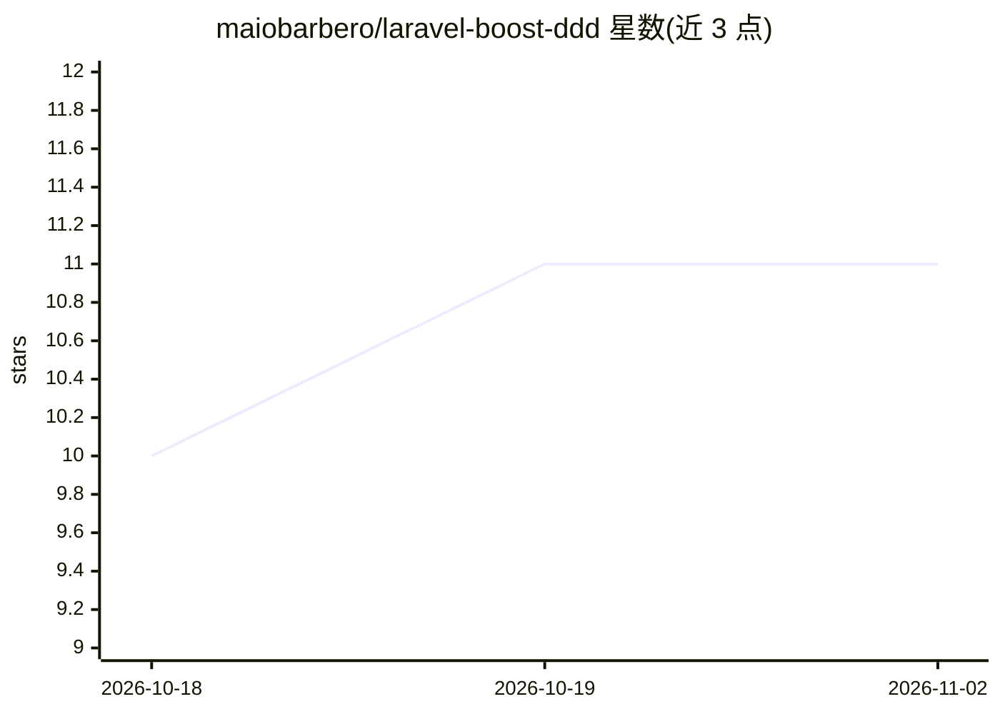

# maiobarbero/laravel-boost-ddd

⭐ 11 · PHP · MIT · 推送 2026-10-27 · [GitHub](https://github.com/maiobarbero/laravel-boost-ddd) · [官网](https://packagist.org/packages/maiobarbero/laravel-boost-ddd) · 个人维护

**给 Laravel 编码 agent 的 DDD 架构规则与技能包**

面向 Laravel Boost 的 Composer 开发依赖包，为编码 agent 提供 DDD 指南、11 个任务专属 agent 技能（创建 Action/Domain Model/Value Object/集成/测试等）和 Pest 架构测试。安装器将包注册进 Boost 配置、发布 DddArchitectureTest.php，检查层间依赖与命名约定。架构上保留 Eloquent 与 Laravel 常规入口，按 Domain/Application/Infrastructure 分层，存量代码不迁移。README 含面向 LLM agent 的安装流程。要求 PHP ^8.3、Laravel Illuminate ^12|^13、Boost ^2.9 与 Pest。

## 筛选速览

| 维度 | 判定 | 备注 |
|---|---|---|
| AI 角色 | `ai-ecosystem` | LLM/agent 周边工具 |
| 许可风险 | `permissive` | MIT |
| 部署形态 | `None` |  |
| 模型依赖 | — | README 未给出锁定关系 |
| 硬件要求 | — | 无带数字的原话,不猜 |
| 安装摩擦 | `low` | 无编译、无系统依赖或容器化 |
| 成熟度 | — | 结构信号不足 |

## 能力要点

- 11 个任务专属 agent 技能（Action/Data/Domain Model/测试等）
- Pest 架构测试检查层与传输依赖、Action handle() 与 Data 后缀
- 增量采纳：存量代码不迁移，仅新任务遵循 DDD 结构
- 包含面向 LLM agent 的安装指令（composer + artisan boost-ddd:install）

## 适用场景

- 让编码 agent 在 Laravel 项目中按 DDD 边界组织新功能
- 通过架构测试约束 Domain/Application/Infrastructure 依赖方向
- 在渐进式重构中为业务复杂度提供明确归属结构

## 场景标签

`编码 Agent` · 领域:编码与开发

## 证据(README 行号)

> L11: Laravel Boost DDD teaches your coding agents how to apply Domain-Driven Design without fighting Laravel.
> L13: It provides Laravel Boost with opinionated guidelines, 11 task-specific agent skills, and Pest architecture tests s
> L123: ## Installation for LLM agents

## 星数曲线

2026-10-18 10 → 2026-11-02 11（+1）

---
*卡片 v1 · prompt 1.4 · 生成 2026-11-02 · 置信度 high · 依据 README sha `fc95b8ff1619` · [字段定义](../../DATASET.md)*
