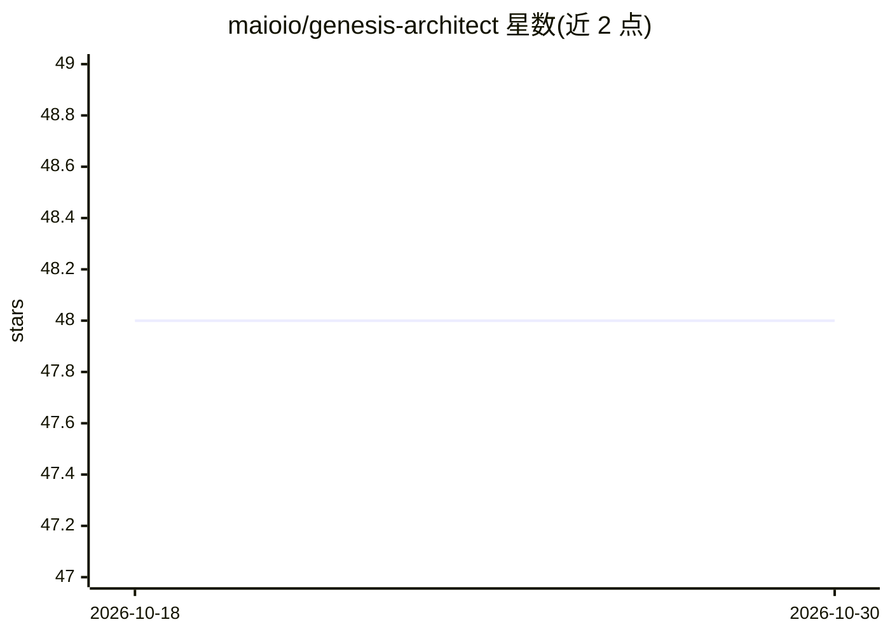

# maioio/genesis-architect

⭐ 48 · Python · AGPL-3.0 · 推送 2026-10-12 · [GitHub](https://github.com/maioio/genesis-architect) · [官网](https://maioio.github.io/genesis-architect/) · 个人维护

**证据驱动的软件架构分析与脚手架工具，含可选 LLM 集成**

Python CLI 工具，覆盖新项目脚手架与既有代码库诊断两条流程：`init` 挖掘 GitHub 仓库与 Issues 中的常见失败模式并生成架构选项；`recover` 基于 AST 构建依赖图，检测导入环、反模式、脆弱模块与漂移并写入报告。分析引擎可完全离线运行、无需 API key，仅在 `init`/`publish` 等命令需 LLM key；变更默认 dry-run 且经审批门控。可作为 Claude Code、Cursor、Codex 的 agent skill 使用，并暴露四个只读 MCP 分析工具。自我审计数据在 CI 中与事实文件比对。Python 分析优先为其声明限制。

## 筛选速览

| 维度 | 判定 | 备注 |
|---|---|---|
| AI 角色 | `ai-enhanced` | 去掉 AI 部分产品仍成立 |
| 许可风险 | `viral` | AGPL-3.0 |
| 部署形态 | `library` | 以包/库形式分发 |
| 模型依赖 | — | README 未给出锁定关系 |
| 硬件要求 | — | 无带数字的原话,不猜 |
| 安装摩擦 | `low` | 无编译、无系统依赖或容器化 |
| 成熟度 | — | 结构信号不足 |

## 能力要点

- `recover` 离线诊断导入环、反模式与脆弱模块，无需 API key、不改动源码
- `init` 挖掘 GitHub Issues 中的失败模式后脚手架，每条建议附来源
- 变更默认 dry-run，策略审批门控，报告仅批准后写入
- 以 agent skill 形式支持 Claude Code、Cursor、Codex，并提供只读 MCP 工具

## 适用场景

- 新项目动手前调研同类工程的已知坑并生成架构选项
- 对既有代码库做导入环、反模式与脆弱性诊断
- 在 Claude Code / Cursor 中作为架构分析技能调用

## 场景标签

`代码生成` · 领域:编码与开发

## 证据(README 行号)

> L108: |Fully offline, no key|`recover`, `harden`, `engines`, `explain`, `memory`, `doctor`, `advise`, `ui`, `decide` (de
> L110: |LLM key or local model|`init`, `publish`; `decide` can add an optional LLM critique that is disclosed when skippe

## 星数曲线

2026-10-18 48 → 2026-10-30 48（+0）

---
*卡片 v1 · prompt 1.4 · 生成 2026-10-25 · 置信度 high · 依据 README sha `3fb5c94d77d3` · [字段定义](../../DATASET.md)*
