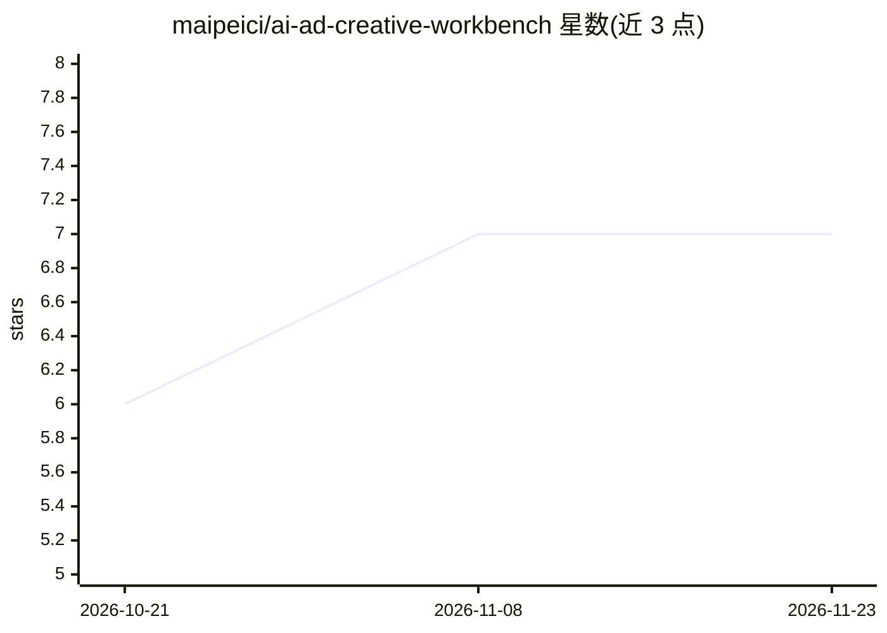

# maipeici/ai-ad-creative-workbench

⭐ 7 · JavaScript · 推送 2026-10-11 · [GitHub](https://github.com/maipeici/ai-ad-creative-workbench) · 个人维护 · 中文 README

**面向广告从业者的 AI 创意、分镜与视频批量制作工作台**

一个 Web 工作台，把广告投放需求到成片的流程组织为七个阶段：品牌素材、投放需求、创意、分镜、视频制作、自动审核与投放迭代。同一创意框架可批量扩展 2–60 个视频版本，逐镜头编辑与重生成；成片由 Agent 观看实际画面做规则审核并给修复建议。支持上传参考视频由 Gemini 拆解脚本。数据保存在本地 JSON 与媒体目录；不接入广告账户发布或自动效果回传，效果数据靠手动 CSV 导入。

## 筛选速览

| 维度 | 判定 | 备注 |
|---|---|---|
| AI 角色 | `ai-native` | 本体是模型或模型工具 |
| 许可风险 | `none` | — |
| 部署形态 | `None` |  |
| 模型依赖 | — | README 未给出锁定关系 |
| 硬件要求 | — | 无带数字的原话,不猜 |
| 安装摩擦 | `medium` | 含编译或系统依赖之一 |
| 成熟度 | — | 结构信号不足 |

## 能力要点

- 七个阶段流程：素材→需求→创意→分镜→制作→审核→投放迭代
- 同创意批量生成多条视频版本，单条失败不阻断整批
- Agent 观看成片做品牌与平台规则审核，输出定位与修复建议
- 爆款参考视频上传后按时间码拆解脚本并可一键导入方案

## 适用场景

- 批量制作 10–20 秒竖屏信息流广告素材
- 导入投放 CSV 数据对比素材 CTR/CVR/CPA 并做二创迭代
- 上传爆款视频拆解脚本作为新创意参考

## 场景标签

`视频生成` `数据分析` · 领域:效率与自动化

## 证据(README 行号)

> L5: **AI 广告创意与素材制作工作台：从投放需求出发，把创意、分镜、视频制作与成片审核串成一个可回看的流程。**
> L122: |`ai`|由模型生成场景与人物画面|
> L138: Agent 直接观看成片，统一检查品牌要求、投放平台规则、项目额外要求、创意一致性及画面声音质量。结果提供规则来源、具体时间段、观察依据和修复建议。修改脚本或制作设置并重新合成后，再复检当前成片；不自动重做收费镜头。

## 星数曲线

2026-10-21 6 → 2026-11-23 7（+1）

---
*卡片 v1 · prompt 1.4 · 生成 2026-11-20 · 置信度 high · 依据 README sha `4778481cb42e` · [字段定义](../../DATASET.md)*
