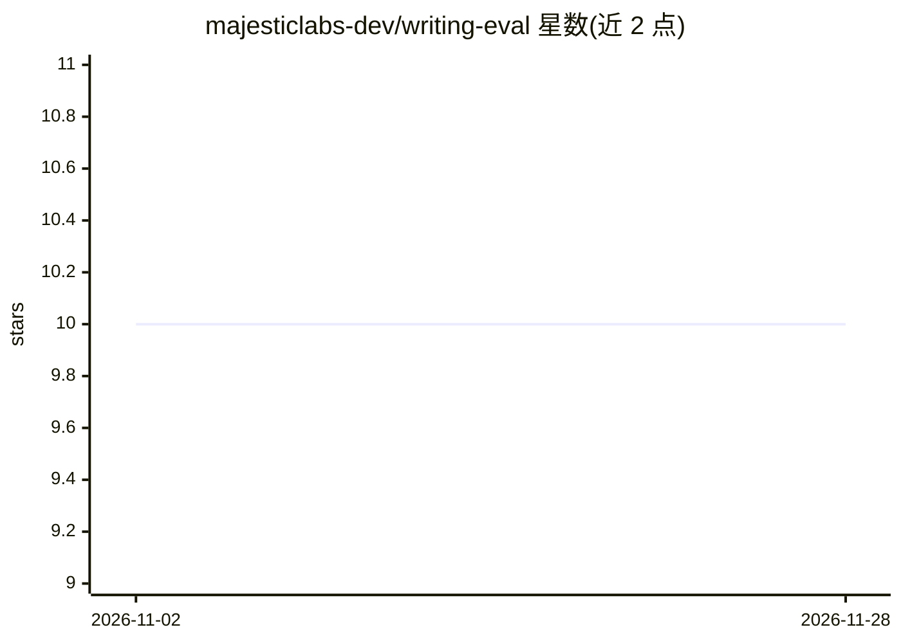

# majesticlabs-dev/writing-eval

⭐ 10 · Python · NOASSERTION · 推送 2026-11-17 · [GitHub](https://github.com/majesticlabs-dev/writing-eval) · [官网](https://majesticlabs.dev/blog/202608/writing-eval-local-quality-control-ai-writing) · 组织维护

**为团队检测 AI 生成文本写作风格偏离的本地评测 CLI**

从参考文集中构建可复用的风格画像，对草稿进行规则化 lint 与画像比对，输出关于清晰度、可读性、句式节奏、词汇与 AI 写作特征的评分报告。全流程在本地 CPU 运行、结果确定，不调用托管模型、不上传源材料。提供单文档检查、语料评测管线（多系统回归对比）、Markdown/JSON 报告与退出码约定，并附带 SKILL.md 供支持该格式的 LLM agent 调用本地 CLI。

## 筛选速览

| 维度 | 判定 | 备注 |
|---|---|---|
| AI 角色 | `ai-native` | 本体是模型或模型工具 |
| 许可风险 | `none` | NOASSERTION |
| 部署形态 | `None` |  |
| 模型依赖 | — | README 未给出锁定关系 |
| 硬件要求 | — | 无带数字的原话,不猜 |
| 安装摩擦 | `low` | 无编译、无系统依赖或容器化 |
| 成熟度 | — | 结构信号不足 |

## 能力要点

- 从作者文集构建确定性风格画像（含 Flesch、MTLD 等统计量与摘要校验）
- 本地 CPU 运行、确定性输出，不调用托管模型
- 语料评测管线支持多写作系统的回归对比
- 附 SKILL.md 使 agent 可加载并正确调用 CLI

## 适用场景

- 检查草稿是否符合团队既定的编辑文风
- 更换提示词或模型后重跑相同检查做回归对比
- 让 agent 按规则调用 CLI 解读报告结果

## 场景标签

 · 领域:LLM 评测/文本分析工具

## 证据(README 行号)

> L7: `writing-eval` gives teams a repeatable way to measure a draft against a chosen
> L16: Everything runs locally on the CPU and produces deterministic results. The tool

## 星数曲线

2026-11-02 10 → 2026-11-28 10（+0）

---
*卡片 v1 · prompt 1.4 · 生成 2026-11-19 · 置信度 mid · 依据 README sha `f312e40d0e84` · [字段定义](../../DATASET.md)*
