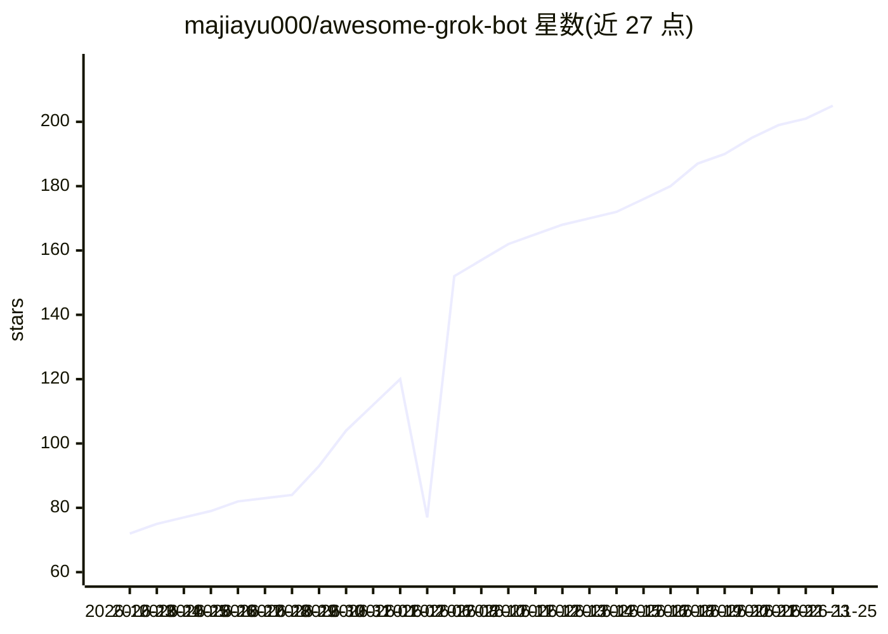

# majiayu000/awesome-grok-bot

⭐ 205 · JavaScript · CC0-1.0 · 推送 2026-11-23 · [GitHub](https://github.com/majiayu000/awesome-grok-bot) · [官网](https://majiayu000.github.io/awesome-grok-bot/) · 个人维护 · 中文 README

**Grok Bot 公开分享页的可检索目录（8,098 条）**

社区维护的双语目录，索引 x.ai/bot 的公开 live share 页面：按 Coding、Inbox、Research、Content 等九类职位分组，catalog.json 提供 featured/solid 等 shelf 编辑导航，配套可过滤的检索网站。每条记录为「配方」式模板，添加时复制名称、技能、例程与工作流记忆，不含个人凭据与自定义插件。声明非 xAI 官方，未与 0 条 verified，收录 8,098 条 listed，另附真实使用案例与 roster 写作。

## 筛选速览

| 维度 | 判定 | 备注 |
|---|---|---|
| AI 角色 | `ai-knowledge` | 知识聚合/清单类 |
| 许可风险 | `viral` | CC0-1.0 |
| 部署形态 | `None` |  |
| 模型依赖 | — | README 未给出锁定关系 |
| 硬件要求 | — | 无带数字的原话,不猜 |
| 安装摩擦 | `low` | 无编译、无系统依赖或容器化 |
| 成熟度 | — | 结构信号不足 |

## 能力要点

- 8,098 条公开分享页目录，按九类职位分组，附 catalog.json 结构化数据
- 双语（英文/中文）界面与可过滤的检索网站
- 收录真实使用案例与多机器人 roster 写作
- 维护者验证标记（verified）与可达性检查日志

## 适用场景

- 为 Grok Bot 挑选现成的 bot 模板分享页
- 查看他人如何用多个 bot 组建工作流 roster
- 按职位类别（编码/邮件/研究/内容等）浏览可用 bot

## 场景标签

`精选清单` · 领域:学习与行业

## 证据(README 行号)

> L13: > Public `x.ai/bot` shares to preview and add, with field cases from people who use them.
> L19: Grok Bot is an always-on AI teammate on a shared cloud computer. This bilingual catalog indexes public **live share
> L19: Grok Bot is an always-on AI teammate on a shared cloud computer. This bilingual catalog indexes public **live share

## 星数曲线

2026-10-23 72 → 2026-11-25 205（+133）

---
*卡片 v1 · prompt 1.4 · 生成 2026-11-25 · 置信度 high · 依据 README sha `a0c33d0be35b` · [字段定义](../../DATASET.md)*
