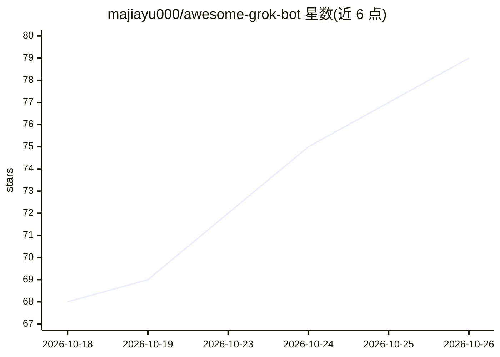

# majiayu000/awesome-grok-bot

⭐ 79 · JavaScript · CC0-1.0 · 推送 2026-10-25 · [GitHub](https://github.com/majiayu000/awesome-grok-bot) · [官网](https://majiayu000.github.io/awesome-grok-bot/) · 个人维护 · 中文 README

**Grok Bot 活分享编目清单：5572 条 x.ai/bot 可预览可添加**

双语维护的 Grok Bot live shares 策展目录：收录 5572 条 x.ai/bot 公开分享链接（非提示词堆），按 8 类职业分组（个人行政 1582 条最多），catalog.json 中以 shelf 分层（featured/solid 等）供编辑导航。每条分享是可复制名称、技能与例程的“配方”，不含文件、密钥与个人记忆。提供可搜索的 GitHub Pages 站点按类别与层级过滤，附大量实测案例与已证实的坑（Gotchas）记录。截至 2026-10-23，5537/5572 分享可达，0 条经维护者验证。

## 筛选速览

| 维度 | 判定 | 备注 |
|---|---|---|
| AI 角色 | `ai-knowledge` | 知识聚合/清单类 |
| 许可风险 | `viral` | CC0-1.0 |
| 部署形态 | `None` |  |
| 模型依赖 | — | README 未给出锁定关系 |
| 硬件要求 | — | 无带数字的原话,不猜 |
| 安装摩擦 | `low` | 无编译、无系统依赖或容器化 |
| 成熟度 | — | 结构信号不足 |

## 能力要点

- 5572 条 x.ai/bot 活分享，按 8 个职业类别组织
- catalog.json 的 shelf 编辑分层（featured/solid/studio-door 等）
- 可搜索的 GitHub Pages 目录站，支持类别+层级过滤
- 收录 staff 确认或截图佐证的 Gotchas 与实测案例（rosters、computer-use jobs）

## 适用场景

- 浏览并挑选现成的 Grok Bot 分享添加到自己的账号
- 参考他人的 bot 编组与 computer-use 实测案例
- 查阅 Grok Bot 已知限制与安全注意事项（无本地 MCP、登录锁定等）

## 场景标签

`精选清单` · 领域:学习与行业

## 证据(README 行号)

> L13: > 5572 live `x.ai/bot` shares for Grok Bot you can preview and Add — plus field cases of how people actually run th
> L17: Grok Bot is an always-on AI teammate on a shared cloud computer. This bilingual catalog indexes public **live share
> L23: Live searchable catalog: majiayu000.github.io/awesome-grok-bot (filter by category + shelf).

## 星数曲线

2026-10-18 68 → 2026-10-26 79（+11）

---
*卡片 v1 · prompt 1.4 · 生成 2026-10-24 · 置信度 high · 依据 README sha `9c78f401c217` · [字段定义](../../DATASET.md)*
