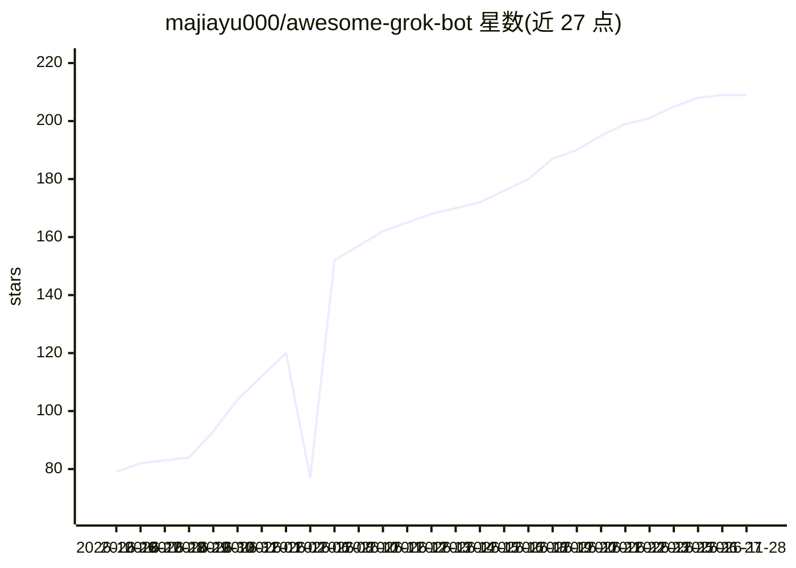

# majiayu000/awesome-grok-bot

⭐ 209 · JavaScript · CC0-1.0 · 推送 2026-11-27 · [GitHub](https://github.com/majiayu000/awesome-grok-bot) · [官网](https://majiayu000.github.io/awesome-grok-bot/) · 个人维护 · 中文 README

**面向 Grok Bot 用户的公开分享页可检索目录**

非官方、社区维护的 x.ai/bot 公开分享页目录：索引可在线打开并一键 Add 的 live share（截至快照共 8275 条、0 条已验证），按工作类别分组并提供可筛选的在线站点。分享被定义为复制名称、技能、例程与工作流记忆的 recipe，不含个人凭据与自定义脚本；添加后需自行重连插件与 API key。附精选入门清单、第三方实测案例（roster 与 computer-use 任务）及双语指南，每日通过批量检查 HTTP 200 增补条目。

## 筛选速览

| 维度 | 判定 | 备注 |
|---|---|---|
| AI 角色 | `ai-knowledge` | 知识聚合/清单类 |
| 许可风险 | `viral` | CC0-1.0 |
| 部署形态 | `None` |  |
| 模型依赖 | locked-api |  |
| 硬件要求 | — | 无带数字的原话,不猜 |
| 安装摩擦 | `low` | 无编译、无系统依赖或容器化 |
| 成熟度 | — | 结构信号不足 |

## 能力要点

- 索引 8275 条公开分享页，支持按类别与 shelf 在线筛选
- 分享页为 recipe 式模板，不含凭据、文件与个人记忆
- 收录第三方 roster 与 computer-use 实测案例
- 每日批量验证链接可用性（HTTP 200）后增量收录

## 适用场景

- 查找并一键添加他人配置好的 Grok Bot 模板
- 按工作类别（编码、邮件、运营等）浏览可复用 Bot
- 参考第三方多 Bot 协作的 roster 实测经验

## 场景标签

`精选清单` · 领域:学习与行业

## 证据(README 行号)

> L19: Grok Bot is an always-on AI teammate on a shared cloud computer. This bilingual catalog indexes public **live share
> L21: > Unofficial, community-maintained catalog. Not affiliated with or endorsed by xAI. Grok is a trademark of xAI.
> L86: |**Total**|**8275**|

## 星数曲线

2026-10-26 79 → 2026-11-28 209（+130）

---
*卡片 v1 · prompt 1.4 · 生成 2026-11-28 · 置信度 high · 依据 README sha `47bc4e81577c` · [字段定义](../../DATASET.md)*
