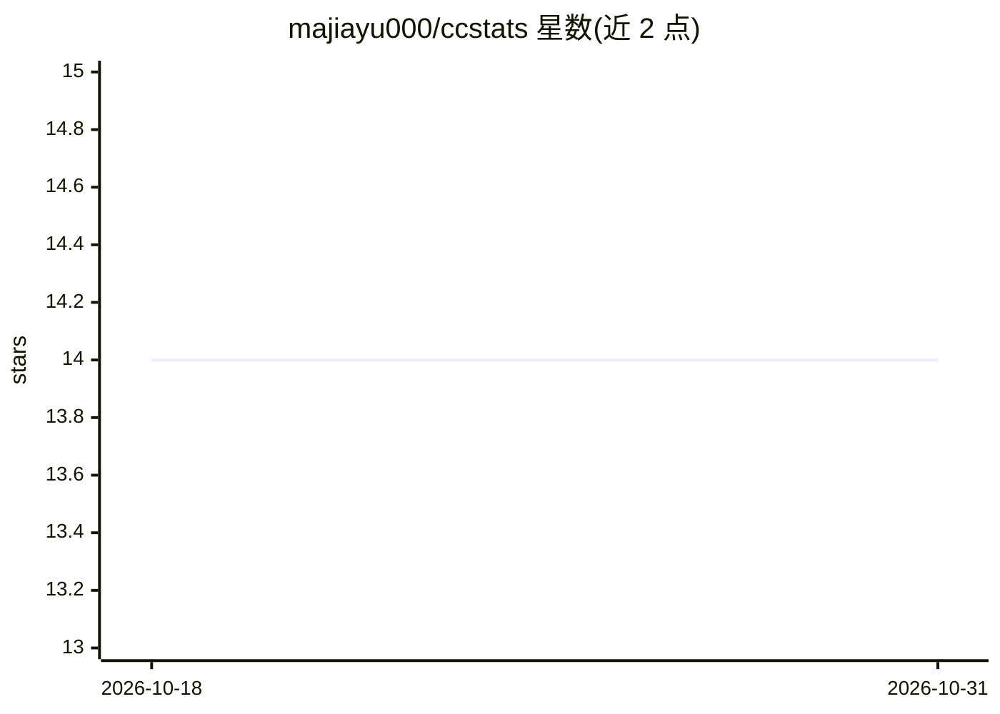

# majiayu000/ccstats

⭐ 14 · Rust · MIT · 推送 2026-10-21 · [GitHub](https://github.com/majiayu000/ccstats) · [官网](https://github.com/majiayu000/ccstats) · 个人维护 · 中文 README

**本地优先的 CLI：分析 29 种 AI 编码代理的 token 与费用**

用 Rust 编写的单二进制 CLI（含待交接的桌面端），读取本机已有的 AI 编码代理使用记录（Claude Code、Codex、Cursor、Gemini CLI、Grok、Kimi Code 等 29 种来源），生成终端报告与 JSON/CSV 输出。提供 diagnose 诊断额度消耗、statusline 实时剩余额度、burn rate 预估、多设备经同步文件夹聚合、只读 MCP 查询与 Rust SDK。本地优先、无遥测，未知费用不显示为 $0，估算值带标注。

## 筛选速览

| 维度 | 判定 | 备注 |
|---|---|---|
| AI 角色 | `ai-ecosystem` | LLM/agent 周边工具 |
| 许可风险 | `permissive` | MIT |
| 部署形态 | `library` | 以包/库形式分发 |
| 模型依赖 | — | README 未给出锁定关系 |
| 硬件要求 | — | 无带数字的原话,不猜 |
| 安装摩擦 | `low` | 无编译、无系统依赖或容器化 |
| 成熟度 | — | 结构信号不足 |

## 能力要点

- 覆盖 29 种 AI 编码代理数据源的 token/费用统计
- diagnose 命令分析缓存读写、会话与版本间额度消耗
- statusline 读取 Claude Code hook JSON 显示官方剩余额度窗口
- 多设备经已有同步文件夹聚合，不接触同步服务

## 适用场景

- 我想知道 Claude Code 订阅额度为什么消耗得快
- 汇总多台设备上各类 AI 编码代理的 token 使用与成本
- 通过 MCP 让 agent 查询自身额度与用量

## 场景标签

 · 领域:开发者工具/用量分析

## 证据(README 行号)

> L11: Local-first token and cost analytics for 29 AI coding-agent data sources. One binary turns
> L122: Agents can query their own limits and usage over MCP (stdio, read-only):

## 星数曲线

2026-10-18 14 → 2026-10-31 14（+0）

---
*卡片 v1 · prompt 1.4 · 生成 2026-10-31 · 置信度 high · 依据 README sha `b7ab3c717932` · [字段定义](../../DATASET.md)*
