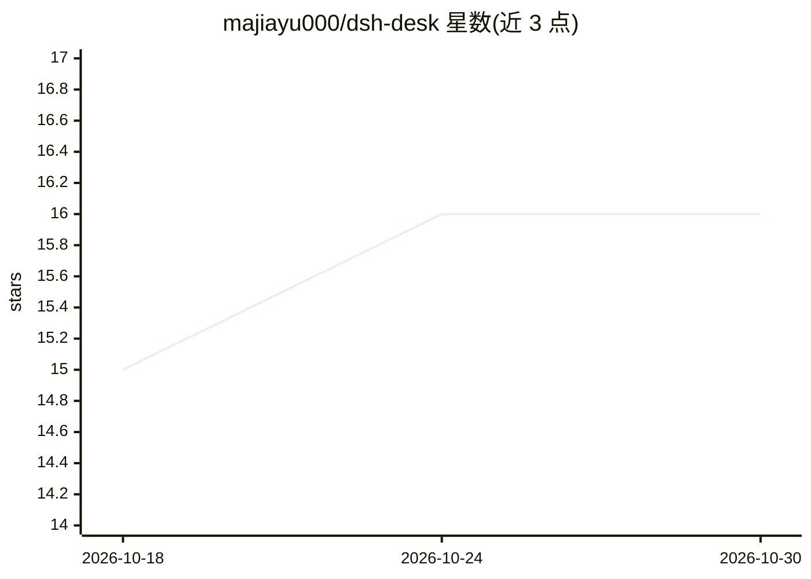

# majiayu000/dsh-desk

⭐ 16 · Rust · MIT · 推送 2026-10-29 · [GitHub](https://github.com/majiayu000/dsh-desk) · [官网](https://www.dshdesk.com) · 个人维护 · 中文 README

**DeepSeek Harness 的桌面发行版：安装即用、内置固定 runtime**

基于 Tauri 2 + 系统 WebView 的桌面应用，将 DeepSeek Harness（Agent runtime 与 Web UI）打包为可安装发行版：内置固定 Node 24 与 Harness runtime，用户无需安装 Node.js 或使用终端。提供随机 loopback 端口、启动 token 健康检查、独立 DSH_HOME 数据目录、插件安装前的来源与 integrity 审查及失败回滚，并以每日自动测试跟踪上游兼容性。macOS 提供 DMG（已签名公证），Windows NSIS（Alpha 未签名），Linux AppImage/deb；当前处于 Alpha 阶段，离线包约 215 MB。

## 筛选速览

| 维度 | 判定 | 备注 |
|---|---|---|
| AI 角色 | `ai-ecosystem` | LLM/agent 周边工具 |
| 许可风险 | `permissive` | MIT |
| 部署形态 | `library` | 以包/库形式分发 |
| 模型依赖 | — | README 未给出锁定关系 |
| 硬件要求 | — | 无带数字的原话,不猜 |
| 安装摩擦 | `low` | 无编译、无系统依赖或容器化 |
| 成熟度 | `idea` | |

## 能力要点

- 内置 Node 24 与固定 Harness runtime，无需另装 Node.js 或终端
- 插件安装前检查来源、integrity、生命周期脚本，失败恢复原 Profile
- 每日测试固定版本与 npm latest 候选，公开兼容矩阵
- 独立 DSH_HOME 数据目录，不污染已有 CLI 环境

## 适用场景

- 想使用 DeepSeek Harness 但不想安装 Node.js 和配置 npm 的用户装好即用
- 需要固定 Harness 版本与可诊断桌面生命周期的使用方式
- 安装 DSH 插件前审查来源与生命周期脚本

## 场景标签

`Agent 框架` · 领域:Agent 开发

## 证据(README 行号)

> L5:  安装即用的 DeepSeek Harness 桌面版。无需另装 Node.js，无需终端。
> L38: DeepSeek Harness 已经拥有 Agent runtime、Web UI、会话、工具、审批、设置和插件协议。DSH Desk 不复制这些业务能力，只负责桌面产品必须可靠拥有的部分：
> L40: - 固定并携带 Node 24 与下方记录的 Harness runtime，普通用户不安装 Node、不敲命令；

## 星数曲线

2026-10-18 15 → 2026-10-30 16（+1）

---
*卡片 v1 · prompt 1.4 · 生成 2026-10-30 · 置信度 high · 依据 README sha `1ec6091d4136` · [字段定义](../../DATASET.md)*
