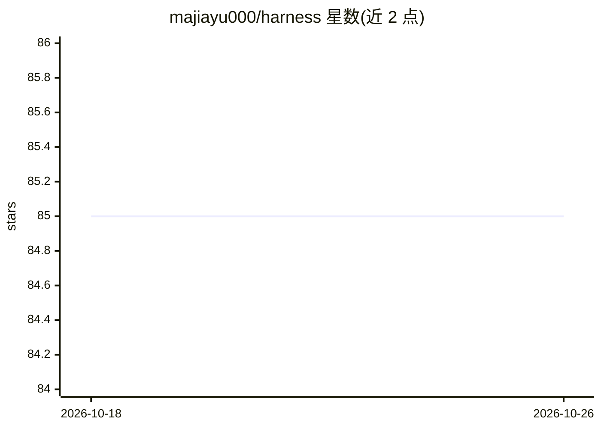

# majiayu000/harness

⭐ 85 · Rust · MIT · 推送 2026-10-21 · [GitHub](https://github.com/majiayu000/harness) · 个人维护

**并行 AI 编码 agent 舰队的 Rust 控制平面：编排、策略与审计**

用 Rust 编写的编码 agent 控制平面：以统一生命周期编排 Claude Code CLI、Codex CLI、Anthropic API 等适配器并行执行任务，提供 Starlark 策略引擎、跨 agent 独立代码评审、信号驱动的垃圾清理与整改草案、GitHub webhook 自动化、OpenTelemetry 追踪导出与 MCP 服务器模式。单次任务只需 Docker 与 provider 凭据；舰队模式需 Postgres 14+ 与 API 认证。以源码分发，cargo build 构建，无发布二进制。

## 筛选速览

| 维度 | 判定 | 备注 |
|---|---|---|
| AI 角色 | `ai-ecosystem` | LLM/agent 周边工具 |
| 许可风险 | `permissive` | MIT |
| 部署形态 | `self-host` | docker 或自建部署 |
| 模型依赖 | locked-api |  |
| 硬件要求 | — | 无带数字的原话,不猜 |
| 安装摩擦 | `low` | 无编译、无系统依赖或容器化 |
| 成熟度 | — | 结构信号不足 |

## 能力要点

- Claude Code / Codex CLI / Anthropic API 的可插拔适配器编排
- Starlark 策略引擎（受限方言）做沙箱化规则评估
- 架构上防止自我评审的跨 agent 代码评审
- OTLP 追踪导出与 MCP JSON-RPC stdio 服务器模式

## 适用场景

- 并行运行多个 AI 编码 agent 处理跨 issue/分支的工作
- 对 agent 执行施加策略与网络白名单管控
- 通过 webhook 从 issue 评论和 PR 评审触发任务
- 用 dashboard 与遥测观测 agent 舰队运行状态

## 场景标签

`多智能体` `编码 Agent` `代码审查` · 领域:Agent 开发

## 证据(README 行号)

> L25: Harness is a Rust-native control plane for that fleet. It wraps AI coding agents (Claude Code, Codex, Anthropic API
> L217: - **Fleet orchestration** — Run many agents in parallel with a unified task/thread/turn lifecycle; pluggable adapt
> L223: - **MCP server mode** — JSON-RPC stdio interface exposing harness tools as an MCP-compatible server

## 星数曲线

2026-10-18 85 → 2026-10-26 85（+0）

---
*卡片 v1 · prompt 1.4 · 生成 2026-10-24 · 置信度 mid · 依据 README sha `98b6a2036f0e` · [字段定义](../../DATASET.md)*
