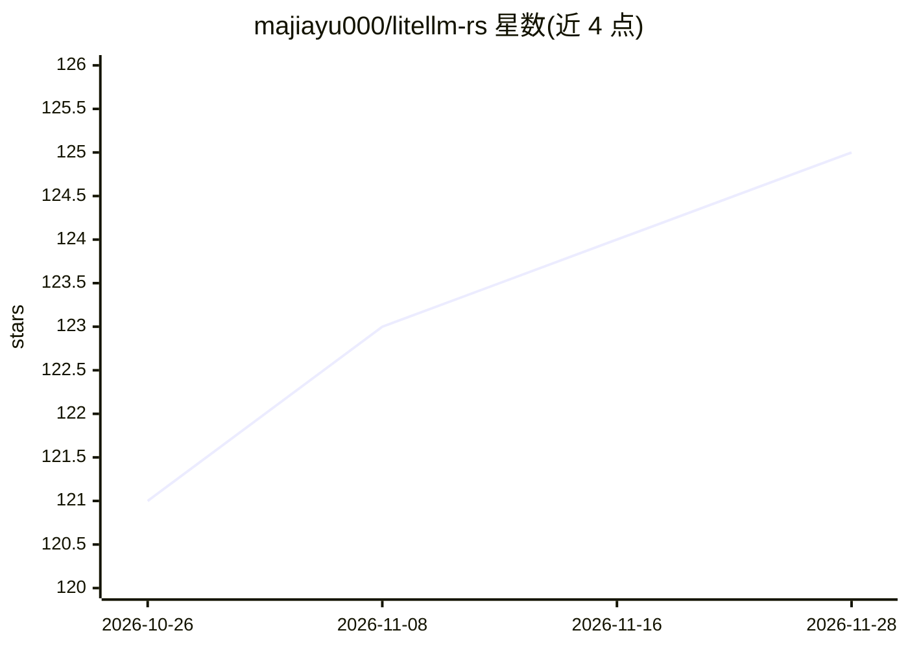

# majiayu000/litellm-rs

⭐ 125 · Rust · MIT · 推送 2026-11-19 · [GitHub](https://github.com/majiayu000/litellm-rs) · [官网](https://docs.rs/litellm-rs) · 个人维护 · 中文 README

**自托管 Rust LLM 网关：统一 OpenAI 兼容 API 与多供应商路由**

用 Rust 编写的自托管 LLM 网关，对外提供稳定的 OpenAI 兼容 HTTP 推理接口，支持 60+ 供应商接入与 50+ OpenAI 兼容供应商目录。核心机制包括负载均衡、故障转移、成本优化路由、确定性缓存、默认开启的提示注入防护、限流与费用账本（基于 SQL 预留账目的 API key 预算）。同时提供可复用的 Rust kernel crate 供库方式集成，带管理控制面 OpenAPI。分发方式包括 Docker 容器、GitHub Release 预编译二进制、cargo install 与源码运行。README 附同机对比 LiteLLM proxy 的基准数据与复现方法。

## 筛选速览

| 维度 | 判定 | 备注 |
|---|---|---|
| AI 角色 | `ai-ecosystem` | LLM/agent 周边工具 |
| 许可风险 | `permissive` | MIT |
| 部署形态 | `self-host` | docker 或自建部署 |
| 模型依赖 | local-ok | 支持本地模型 |
| 硬件要求 | — | 无带数字的原话,不猜 |
| 安装摩擦 | `low` | 无编译、无系统依赖或容器化 |
| 成熟度 | — | 结构信号不足 |

## 能力要点

- OpenAI 兼容稳定推理契约 + 管理控制面双 OpenAPI
- 负载均衡、故障转移、熔断器与成本优化路由配置
- SQL 预留账本实现 API key 生命周期预算
- SSRF 防护：配置加载、每请求与 DNS 解析三重端点校验

## 适用场景

- 自托管网关统一接入多个 LLM 供应商并做负载均衡与故障转移
- 为团队管理 API key、预算与费用账本
- 以 Rust 库方式将多供应商推理接入自有应用

## 场景标签

`模型网关` · 领域:Agent 开发

## 证据(README 行号)

> L3: A high-performance self-hosted LLM gateway with a stable
> L40: - **Intelligent Routing** - Load balancing, failover, cost optimization
> L119: |Self-hosted HTTP gateway|Primary product. Stable inference routes follow the published OpenAPI contract; configur

## 星数曲线

2026-10-26 121 → 2026-11-28 125（+4）

---
*卡片 v1 · prompt 1.4 · 生成 2026-11-28 · 置信度 mid · 依据 README sha `d6a4e43b56ef` · [字段定义](../../DATASET.md)*
