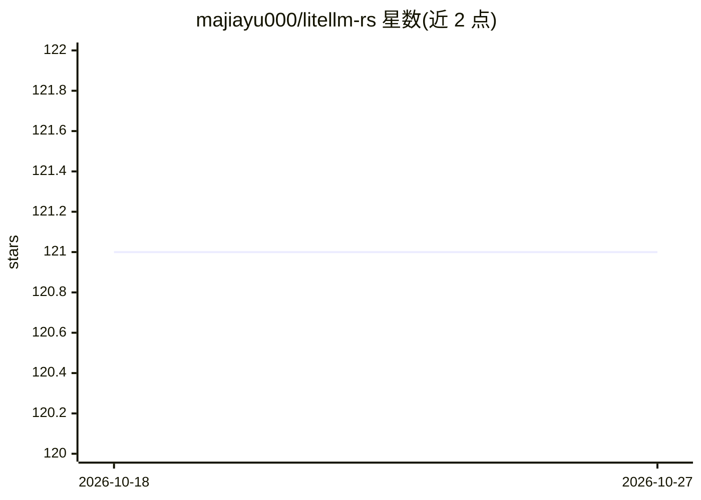

# majiayu000/litellm-rs

⭐ 121 · Rust · MIT · 推送 2026-10-15 · [GitHub](https://github.com/majiayu000/litellm-rs) · [官网](https://docs.rs/litellm-rs) · 个人维护

**Rust 自托管 LLM 网关：OpenAI 兼容 API、负载均衡与故障转移**

以 Rust 实现的自托管 LLM 网关，对外提供版本化的 OpenAI 兼容推理契约（GET /openapi.json）与管理面 OpenAPI（认证、密钥、团队、预算、路由）。运行时接入 60+ 提供商（OpenAI、Anthropic、AWS Bedrock 等，另含 50+ OpenAI 兼容提供商），支持负载均衡、故障转移、成本优化路由，默认开启提示注入防护、限流、确定性缓存与指标。同时以 litellm-rs crate 形式提供可复用 Rust 内核（LLMClient、DefaultRouter）。预算计数为进程本地，重启不恢复；Perplexity Sonar、GitHub Models、Lambda 等选择器已退役。面向自建网关与库使用的开发者。

## 筛选速览

| 维度 | 判定 | 备注 |
|---|---|---|
| AI 角色 | `ai-ecosystem` | LLM/agent 周边工具 |
| 许可风险 | `permissive` | MIT |
| 部署形态 | `library` | 以包/库形式分发 |
| 模型依赖 | local-ok | 支持本地模型 |
| 硬件要求 | — | 无带数字的原话,不猜 |
| 安装摩擦 | `low` | 无编译、无系统依赖或容器化 |
| 成熟度 | `idea` | |

## 能力要点

- 60+ 运行时接入提供商，含 Tier 1 目录的 50+ OpenAI 兼容提供商
- 负载均衡、熔断器、故障转移与基于优先级的主备分层路由
- 默认开启提示注入防护、IP 访问控制、限流与确定性缓存
- crate 形式的可复用 Rust 内核（LLMClient::from_runtime / DefaultRouter）

## 适用场景

- 自建统一 LLM 网关，用 OpenAI 兼容 API 聚合多家提供商
- 在 Rust 应用中以库形式引入多提供商 completion/embedding 能力
- 通过模型别名与优先级分层做灰度与回滚路由

## 场景标签

`模型网关` · 领域:Agent 开发

## 证据(README 行号)

> L3: A high-performance self-hosted LLM gateway with a stable
> L14: - **60+ runtime-wired providers** - OpenAI, Anthropic, AWS Bedrock, Mistral, Cloudflare, plus 50+ OpenAI-compatible
> L18: - **Intelligent Routing** - Load balancing, failover, cost optimization

## 星数曲线

2026-10-18 121 → 2026-10-27 121（+0）

---
*卡片 v1 · prompt 1.4 · 生成 2026-10-23 · 置信度 mid · 依据 README sha `3283d62b4d81` · [字段定义](../../DATASET.md)*
