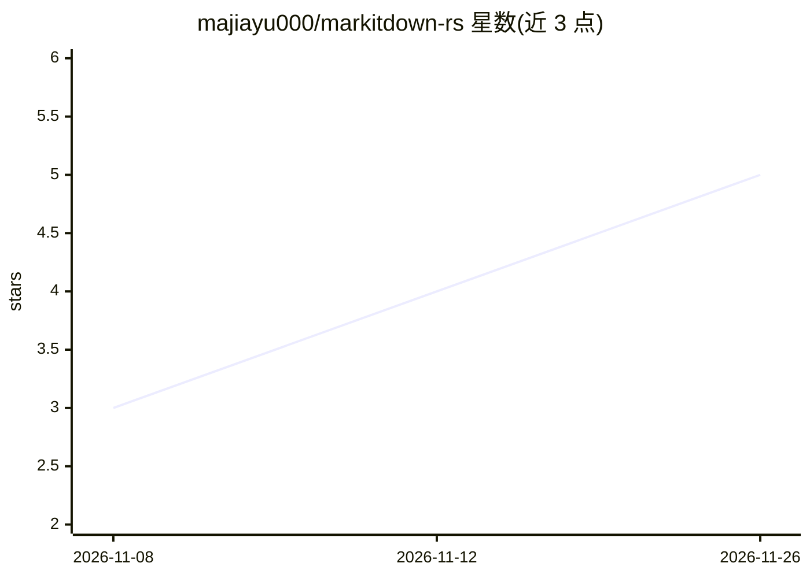

# majiayu000/markitdown-rs

⭐ 5 · Rust · MIT · 推送 2026-11-25 · [GitHub](https://github.com/majiayu000/markitdown-rs) · [官网](https://majiayu000.github.io/markitdown-rs/) · 个人维护

**为 LLM/RAG 管线将文档转为 Markdown 的 Rust 重写 CLI**

markitdown-rs 将 PDF、Word、PowerPoint、Excel、HTML、EPUB、Outlook 消息及网页转换为 Markdown，面向 LLM 与 RAG 管线。它是 microsoft/markitdown 的 Rust 重写，以 4.5 MB 单二进制运行、无需 Python 环境，目标为与 Python 版输出逐字节一致（以 Python markitdown 0.1.9 做逐字节对照测试，406 个测试文件中 401 个一致）。提供 CLI、Rust 库、兼容 markitdown API 的 Python 模块，以及支持 stdio/HTTP 的 MCP 服务器。CLI 不含音频转录、LLM 图片描述、Azure 服务与插件功能，这些由 Python 模块承担。

## 筛选速览

| 维度 | 判定 | 备注 |
|---|---|---|
| AI 角色 | `ai-ecosystem` | LLM/agent 周边工具 |
| 许可风险 | `permissive` | MIT |
| 部署形态 | `desktop` | 安装包/桌面程序 |
| 模型依赖 | — | README 未给出锁定关系 |
| 硬件要求 | — | 无带数字的原话,不猜 |
| 安装摩擦 | `medium` | 含编译或系统依赖之一 |
| 成熟度 | — | 结构信号不足 |

## 能力要点

- CLI、Python 模块（PyO3）与 MCP 服务器三种形态，基于同一套 Rust 转换器
- 以逐字节对照测试验证与 Python markitdown 的输出兼容性（408 个 fixture + html5lib 套件 6,705 输入）
- MCP 服务器兼容 markitdown-mcp 工具协议，可接入 Claude Code、Claude Desktop、Cursor
- 支持文件、stdin、http/https/file/data URI 多种输入源，含 Wikipedia/Bing/YouTube 专用转换

## 适用场景

- 为 RAG 索引批量转换 Office/PDF 文档为 Markdown
- 在不依赖 Python 的 CI 或服务中复用 markitdown 转换结果
- 作为 MCP 工具向 AI 客户端提供文档转换能力

## 场景标签

`文档解析` · 领域:知识与检索

## 证据(README 行号)

> L7: **markitdown-rs converts PDF, Word, PowerPoint, Excel, HTML, EPUB, Outlook
> L22: It also runs as an MCP server for AI agents (`markitdown mcp`, stdio or
> L233: `markitdown mcp` serves the Model Context Protocol

## 星数曲线

2026-11-08 3 → 2026-11-26 5（+2）

---
*卡片 v1 · prompt 1.4 · 生成 2026-11-21 · 置信度 high · 依据 README sha `5957903730c0` · [字段定义](../../DATASET.md)*
