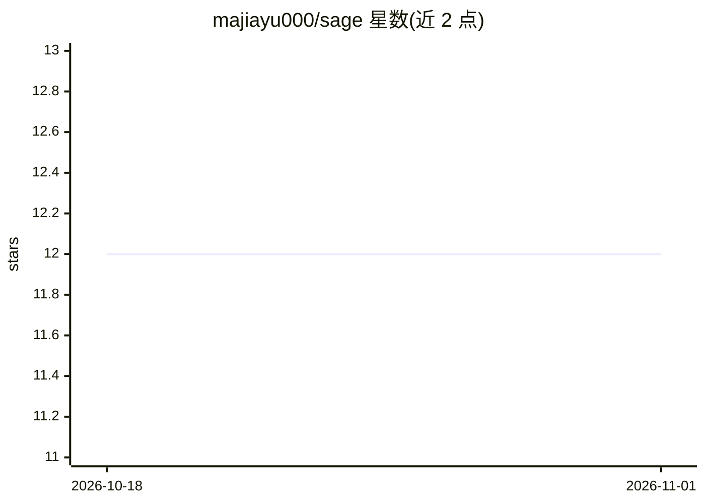

# majiayu000/sage

⭐ 12 · Rust · MIT · 推送 2026-10-23 · [GitHub](https://github.com/majiayu000/sage) · [官网](https://docs.rs/sage-cli) · 组织维护 · 中文 README

**给开发者的 Rust 单二进制 AI 编程 agent CLI，多模型可续会话**

Rust 实现的软件工程 agent CLI，以约 15MB 单二进制分发，命令为 sage。支持 Anthropic、OpenAI、Google、Ollama、Azure OpenAI、OpenRouter、GLM、Doubao 等多家 LLM 提供商及 OpenAI 兼容路由；内置 40+ 工具（文件操作、Shell、Git、Web、规划）、MCP 协议扩展、跨会话记忆（opt-in）与会话检查点/恢复，兼容 Claude Code 风格的 16+ 斜杠命令。仅 Ollama 后端的工作流面向离线使用，云模型需自备 API key。仓库处于 maintenance-only 状态，Windows 无预编译包，需 WSL2 或源码构建。

## 筛选速览

| 维度 | 判定 | 备注 |
|---|---|---|
| AI 角色 | `ai-native` | 本体是模型或模型工具 |
| 许可风险 | `permissive` | MIT |
| 部署形态 | `library` | 以包/库形式分发 |
| 模型依赖 | local-ok | 支持本地模型 |
| 硬件要求 | — | 无带数字的原话,不猜 |
| 安装摩擦 | `low` | 无编译、无系统依赖或容器化 |
| 成熟度 | — | 结构信号不足 |

## 能力要点

- 单约 15MB 二进制，提供 install.sh/cargo/Homebrew 三种安装途径
- 支持 10 家 LLM 提供商及 OpenAI 兼容路由，Ollama 可离线推理
- 40+ 内置工具与 MCP 协议、插件系统扩展
- 会话可恢复（sage -c/-r）、检查点、轨迹记录与跨会话记忆（opt-in）

## 适用场景

- 在代码仓库中用自然语言执行探索、修改、重构等工程任务
- 接本地 Ollama 模型做离线编程辅助
- 中断后通过会话 ID 恢复之前的任务上下文

## 场景标签

`编码 Agent` · 领域:编码与开发

## 证据(README 行号)

> L7: Open-source software engineering agent CLI.
> L19: Sage Agent is the Rust coding-agent CLI distributed as `sage-cli`; the command
> L110: - **Fast startup path** - Rust-native binary with a local benchmark script for verification

## 星数曲线

2026-10-18 12 → 2026-11-01 12（+0）

---
*卡片 v1 · prompt 1.4 · 生成 2026-11-01 · 置信度 high · 依据 README sha `df543ebd0989` · [字段定义](../../DATASET.md)*
