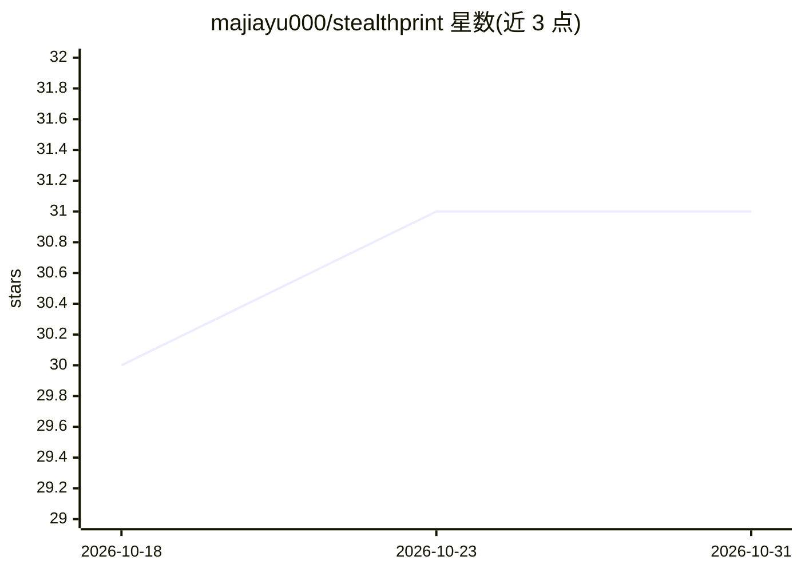

# majiayu000/stealthprint

⭐ 31 · Python · MIT · 推送 2026-10-30 · [GitHub](https://github.com/majiayu000/stealthprint) · 个人维护 · 中文 README

**对匿名 LLM 端点做指纹识别的 Python 工具库**

面向 OpenAI 兼容端点的模型指纹工具库：通过分词器差分、包装器开销、上下文长度阶梯、错误样式、视觉/视频探针等多层测量，比对候选分词器文件，推断端点后匿名模型的身份线索。提供 CLI 与 Python API，endpoint/model/API key 均显式传入，不绑定模型名。配套静态调查站点构建与每五分钟一次的目录监控工作流。测量结果为证据而非身份证明，target API 调用可能产生计费。

## 筛选速览

| 维度 | 判定 | 备注 |
|---|---|---|
| AI 角色 | `ai-ecosystem` | LLM/agent 周边工具 |
| 许可风险 | `permissive` | MIT |
| 部署形态 | `library` | 以包/库形式分发 |
| 模型依赖 | — | README 未给出锁定关系 |
| 硬件要求 | — | 无带数字的原话,不猜 |
| 安装摩擦 | `low` | 无编译、无系统依赖或容器化 |
| 成熟度 | — | 结构信号不足 |

## 能力要点

- 7 层指纹测量（tokenizer/wrapper/context/errors/vision/video/catalog）
- 内置覆盖 12+ 语言的多语言探针集与自定义探针支持
- CLI 与 Python API，身份参数显式传入、不绑定模型名
- 配套调查站点构建脚本与定时目录监控工作流

## 适用场景

- 识别匿名/隐蔽端点背后模型的分词器归属
- 对比同一网关不同入口的固定开销差异
- 留存带时间戳的请求与响应证据用于复现

## 场景标签

 · 领域:AI 研究/模型测量工具

## 证据(README 行号)

> L5: A reusable library for fingerprinting stealth / anonymous models served behind
> L141: |Layer|Command|Answers|

## 星数曲线

2026-10-18 30 → 2026-10-31 31（+1）

---
*卡片 v1 · prompt 1.4 · 生成 2026-10-26 · 置信度 high · 依据 README sha `e8f1e962be21` · [字段定义](../../DATASET.md)*
