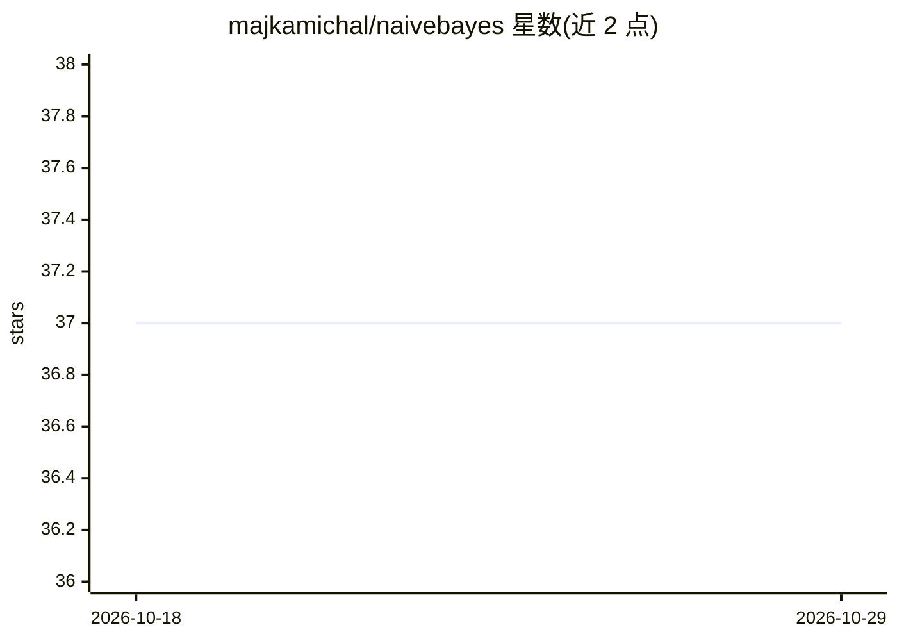

# majkamichal/naivebayes

⭐ 37 · R · GPL-2.0 · 推送 2025-11-21 · [GitHub](https://github.com/majkamichal/naivebayes) · [官网](https://majkamichal.github.io/naivebayes/) · 个人维护

**R 语言朴素贝叶斯分类器包，仅依赖 Base R**

R 包 naivebayes，提供朴素贝叶斯分类的通用实现 naive_bayes() 与五个专用函数（Bernoulli/多项/Poisson/高斯/非参数）。通用函数按特征类型支持 categorical、Poisson、高斯与核密度估计分布；专用函数利用线性代数运算处理稠密矩阵，可利用矩阵稀疏性并支持缺失数据。设计原则为仅依赖 Base R，无外部依赖（可选利用 Matrix 包的稀疏矩阵，但非必需）。可从 CRAN 或 GitHub 安装，并可通过 Caret 包调用。

## 筛选速览

| 维度 | 判定 | 备注 |
|---|---|---|
| AI 角色 | `ai-native` | 本体是模型或模型工具 |
| 许可风险 | `viral` | GPL-2.0 |
| 部署形态 | `None` |  |
| 模型依赖 | — | README 未给出锁定关系 |
| 硬件要求 | — | 无带数字的原话,不猜 |
| 安装摩擦 | `low` | 无编译、无系统依赖或容器化 |
| 成熟度 | — | 结构信号不足 |

## 能力要点

- 通用 naive_bayes() 支持 categorical/Poisson/Gaussian/核密度估计四种条件分布
- 五个专用朴素贝叶斯函数，支持稠密/稀疏矩阵与缺失数据
- 仅依赖 Base R，无外部依赖
- 非参数估计提供 7 种平滑核与 5 种带宽选择器

## 适用场景

- 在 R 中对带离散/连续/计数特征的数据做分类
- 通过 Caret 工作流调用朴素贝叶es 分类器
- 对连续特征用核密度估计替代高斯假设建模

## 场景标签

 · 领域:机器学习/统计计算

## 证据(README 行号)

> L17: The `naivebayes` package presents an efficient implementation of the
> L29: The `naive_bayes()` function is designed to determine the class of each

## 星数曲线

2026-10-18 37 → 2026-10-29 37（+0）

---
*卡片 v1 · prompt 1.4 · 生成 2026-10-25 · 置信度 high · 依据 README sha `5e5c1e1777ea` · [字段定义](../../DATASET.md)*
