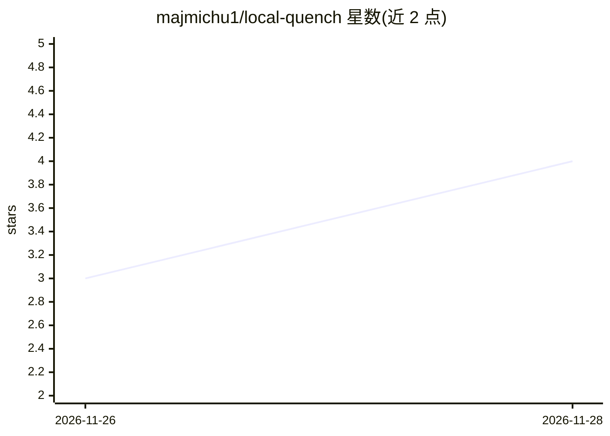

# majmichu1/local-quench

⭐ 4 · Python · NOASSERTION · 推送 2026-11-20 · [GitHub](https://github.com/majmichu1/local-quench) · [官网](https://www.localquench.com) · 个人维护

**本地 LLM 的 AI 编码 agent：本地跑模型改代码，内置基准**

一个面向本地大模型的 AI 编码 agent 应用：打开项目文件夹后选择本地模型，agent 读取代码、执行编辑、运行命令与测试并汇报变更。围绕模型提供 harness 机制，监测本地模型常见失效模式（宣布步骤后停止、改测试直到通过、重复编辑已变更文件等）并将其拉回轨道，每条规则可单独关闭并测量。分发为 Windows/Linux/macOS/Android 安装包，源码未公开，附带 quenchbench.py 基准脚本与 26 个公开任务样例。

## 筛选速览

| 维度 | 判定 | 备注 |
|---|---|---|
| AI 角色 | `ai-ecosystem` | LLM/agent 周边工具 |
| 许可风险 | `none` | NOASSERTION |
| 部署形态 | `desktop` | 安装包/桌面程序 |
| 模型依赖 | local-ok | 支持本地模型 |
| 硬件要求 | — | 无带数字的原话,不猜 |
| 安装摩擦 | `low` | 无编译、无系统依赖或容器化 |
| 成熟度 | — | 结构信号不足 |

## 能力要点

- 内置 llama.cpp 引擎自跑模型，或对接 LM Studio/Ollama/vLLM/llama-server
- harness 监测并纠正本地模型失效模式，每条规则可关闭并量化
- 内置 QuenchBench 编码基准，另支持 SWE-bench/Terminal-Bench/Aider Polyglot
- Agent Bridge 经 MCP 让 Claude Code 将任务下放给本地模型

## 适用场景

- 在本地 GPU 上让 agent 修复项目中的失败测试
- 测量本地模型在各类编码任务上的可靠程度
- 用 Claude Code 做规划、本地模型执行编辑-测试循环
- 按显存查找适配的模型与量化方案

## 场景标签

`编码 Agent` `模型评测` · 领域:编码与开发

## 证据(README 行号)

> L4:  Runs your local models itself with a built-in llama.cpp engine, or through LM Studio, Ollama or vLLM. Your code sta
> L39: The difference from other agents is the harness around the model. Local models trip over things a
> L56: - **Agent Bridge.** Claude Code can hand a coding task to your local model over MCP and read back the result and

## 星数曲线

2026-11-26 3 → 2026-11-28 4（+1）

---
*卡片 v1 · prompt 1.4 · 生成 2026-11-26 · 置信度 high · 依据 README sha `37fb972c5e1e` · [字段定义](../../DATASET.md)*
