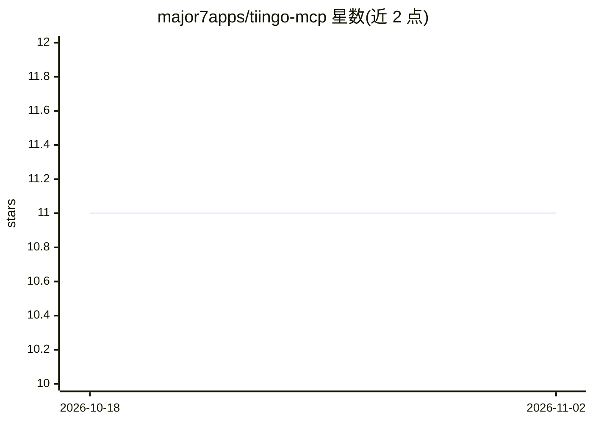

# major7apps/tiingo-mcp

⭐ 11 · Rust · MIT · 推送 2026-10-26 · [GitHub](https://github.com/major7apps/tiingo-mcp) · [官网](https://crates.io/crates/tiingo-mcp) · 组织维护

**Rust 编写的 Tiingo 金融数据 MCP 服务器（38 个工具）**

面向 MCP 客户端（如 Claude Code、Claude Desktop）的 Model Context Protocol 服务器，用 Rust 编写，从 Tiingo 获取股票 EOD/IEX/盘后 BOATS 价格、外汇、加密货币与 Crypto Yield、基金费率、金融新闻、公司基本面与股息拆股等数据，共 38 个工具，另有 3 个固定资源、1 个资源模板和 5 个提示词。经 stdio 与客户端通信，订阅工具使用 WebSocket 连接 Tiingo；需 Tiingo API key，数据访问取决于 key 开通的功能。提供 macOS/Linux/Windows 预编译二进制，无需 Rust 即可安装。

## 筛选速览

| 维度 | 判定 | 备注 |
|---|---|---|
| AI 角色 | `ai-ecosystem` | LLM/agent 周边工具 |
| 许可风险 | `permissive` | MIT |
| 部署形态 | `desktop` | 安装包/桌面程序 |
| 模型依赖 | — | README 未给出锁定关系 |
| 硬件要求 | — | 无带数字的原话,不猜 |
| 安装摩擦 | `low` | 无编译、无系统依赖或容器化 |
| 成熟度 | `idea` | |

## 能力要点

- 38 个 MCP 工具覆盖股票/外汇/加密货币/新闻/基本面/公司行为
- 预编译二进制支持 macOS（Apple silicon 与 Intel）、Linux（musl 静态链接）、Windows
- 提供 MCPB 桌面捆绑包与 crates.io Cargo 安装途径
- 发布产物带 sha256 校验与 GitHub build attestations

## 适用场景

- 让 Claude 等 MCP 客户端查询股票、外汇、加密货币行情
- 通过 agent 检索金融新闻与公司财务报表
- 获取股息、拆股等公司行为历史数据

## 场景标签

`金融量化` · 领域:学习与行业

## 证据(README 行号)

> L6: `tiingo-mcp` is a Rust Model Context Protocol (MCP) server for stock market data from Tiingo. Use it with Claude Cod
> L8: The server exposes 38 tools, and it also provides three fixed resources, one resource template, and five prompts. Th
> L158: The server talks to its MCP client over stdio, which means the client starts it as a child process and exchanges m

## 星数曲线

2026-10-18 11 → 2026-11-02 11（+0）

---
*卡片 v1 · prompt 1.4 · 生成 2026-11-02 · 置信度 high · 依据 README sha `4e34589ddcc0` · [字段定义](../../DATASET.md)*
