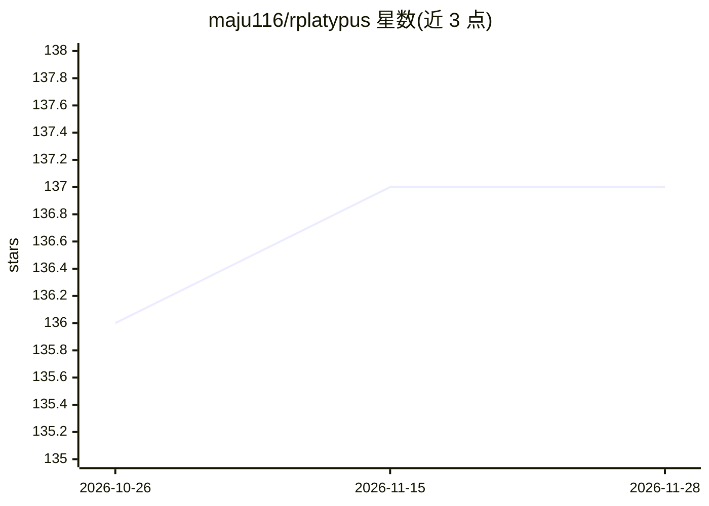

# maju116/rplatypus

⭐ 137 · R · NOASSERTION · 推送 2026-11-13 · [GitHub](https://github.com/maju116/rplatypus) · [官网](https://maju116.github.io/rplatypus/) · 个人维护

**R 用户的医学图像深度学习包：分割/检测/分类，DICOM 与 NIfTI**

面向 R 的医学图像深度学习包（CRAN），支持 2D/3D 语义与实例分割、目标检测、图像级与多标签分类，读取 DICOM 与 NIfTI。通过 reticulate 在安装时自动构建隔离的 Python 环境运行 pyplatypus/PyTorch 引擎，用户只写 R。提供 U-Net/U-Net++/Res-U-Net/LinkNet 四种架构、11 种分割损失与 5 种指标、3D 数据增强、按患者分组的数据划分、YAML 实验配置、发布权重加载。声明为 alpha 重写版，API 仍可能变动。

## 筛选速览

| 维度 | 判定 | 备注 |
|---|---|---|
| AI 角色 | `ai-native` | 本体是模型或模型工具 |
| 许可风险 | `none` | NOASSERTION |
| 部署形态 | `library` | 以包/库形式分发 |
| 模型依赖 | — | README 未给出锁定关系 |
| 硬件要求 | — | 无带数字的原话,不猜 |
| 安装摩擦 | `medium` | 含编译或系统依赖之一 |
| 成熟度 | `idea` | |

## 能力要点

- 四种分割架构，11 种分割损失与 5 种指标，可选排除背景
- DICOM/NIfTI 3D 流程：重采样到共同 voxel 尺寸、series_report 校验、掩膜按原扫描网格写回
- 按患者而非切片划分数据集，并逐病例评估而非仅数据集均值
- YAML 与 R 参数产生同一 spec，可交付复现；发布权重按 commit 固定

## 适用场景

- 对 DICOM 或 NIfTI 医学扫描做 3D U-Net 分割训练
- 组织病理大图切成网格后训练并还原全尺寸掩膜
- 加载发布的 dsbowl-unet 权重直接推理并可视化掩膜
- 多 MRI 序列按命名规则堆叠为多通道输入

## 场景标签

`目标检测` · 领域:感知与多模态

## 证据(README 行号)

> L3: **Segmentation and object detection for medical images, from a folder of pictures to a
> L19: piece — not a wrapper around a Python library you then have to learn, but an R package

## 星数曲线

2026-10-26 136 → 2026-11-28 137（+1）

---
*卡片 v1 · prompt 1.4 · 生成 2026-11-28 · 置信度 mid · 依据 README sha `baaa71b39079` · [字段定义](../../DATASET.md)*
